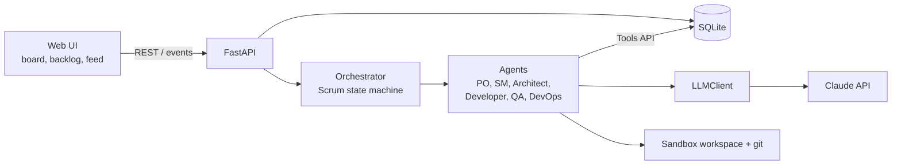
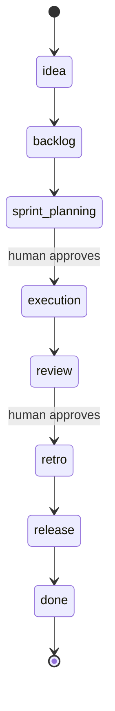
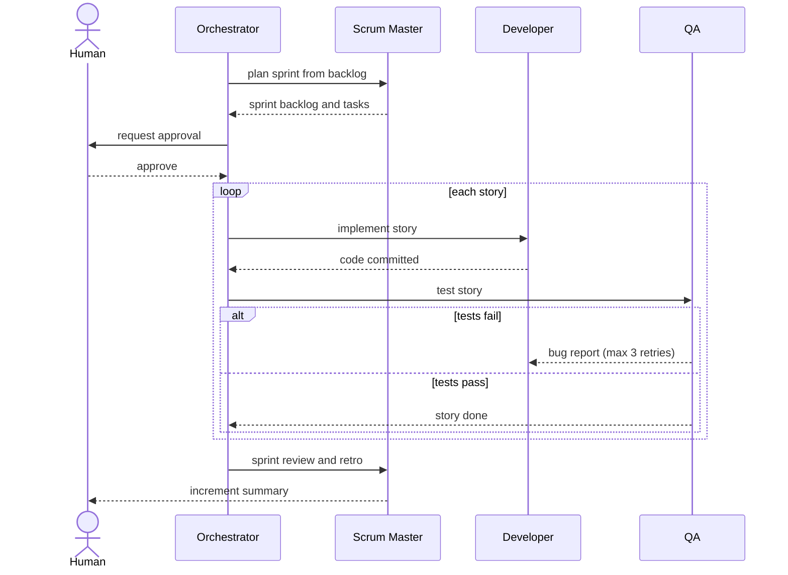
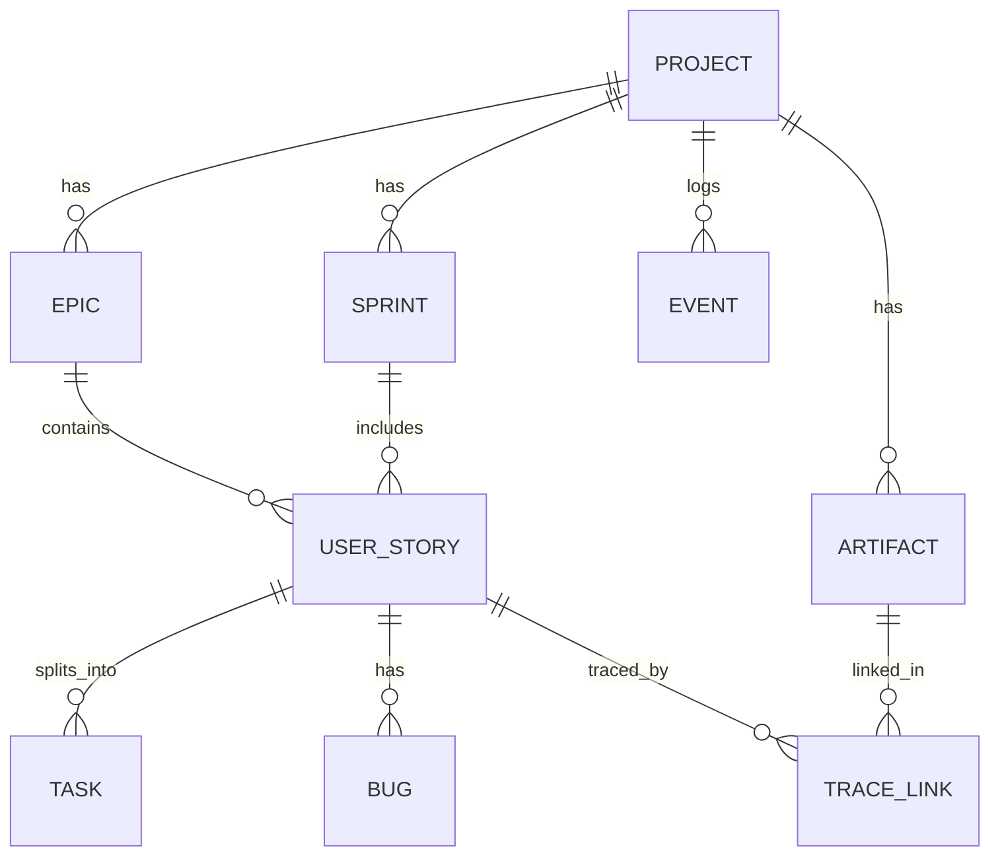

# Scrum Agents Workbench

[](https://github.com/Muniya-64bit/scrum-agents-workbench/actions/workflows/ci.yml)


A multi-agent **CASE workbench for Scrum**. You give it a product idea; a team of LLM agents,
each playing a Scrum role, takes it through the software development life cycle in sprints and
produces real artifacts: backlog, design, code, tests and a release. A human approves the key
ceremonies.

> **Status:** Day 1 foundation is in place (data model, LLM wrapper, agent base class,
> orchestrator, REST API). All six agents currently run as stubs; real agents are tracked in the
> [issues](https://github.com/Muniya-64bit/scrum-agents-workbench/issues).

## Contents
- [Features](#features)
- [How it works](#how-it-works)
- [Quickstart](#quickstart)
- [Configuration](#configuration)
- [API](#api)
- [Project structure](#project-structure)
- [Developing an agent](#developing-an-agent)
- [Testing and linting](#testing-and-linting)
- [Roadmap](#roadmap)
- [Team and workflow](#team-and-workflow)
- [Documentation](#documentation)

## Features
- Six role-based agents: Product Owner, Scrum Master, Architect, Developer, QA, DevOps
- Scrum state machine with human approval gates at sprint planning and sprint review
- Traceability matrix story → design → code → tests with an artifact viewer
- Metrics dashboard (GQM): burndown, velocity, quality, AI cost
- Retrospective levers that change the next sprint, a versioned release per sprint and a
  Plan-Do-Check-Act view of the improvement
- Schema-validated agent output with retries, response caching and token usage logging
- Mock mode (`MOCK_LLM=1`) so development and tests cost no tokens
- Append-only event log that feeds the activity feed

## How it works

### System architecture


### Agents and the SDLC
| Agent | Scrum role | SDLC phase | Outputs |
|---|---|---|---|
| Product Owner | PO | Requirements | Vision, epics, user stories, acceptance criteria |
| Scrum Master | SM | Planning, process | Sprint plan, stand-ups, burndown, retrospective |
| Architect | Dev team | Design | Architecture, API spec, Mermaid/UML diagrams |
| Developer | Dev team | Implementation | Code committed per story |
| QA | Dev team | Testing | Tests from acceptance criteria, bug reports |
| DevOps | Dev team | Deploy | Dockerfile, CI workflow, release notes |

### Scrum state machine
Phases marked with a gate pause until a human approves.


### How the team improves each sprint
The retrospective turns the sprint's measured results into typed process changes: the next
capacity, the fix-retry limit, test-first and working agreements. Unfinished stories go back to the
backlog. The next sprint is planned with those levers and records the process it used, and every
sprint ends with a tagged release (`v0.1.0`, `v0.2.0`, ...). After a release the orchestrator plans
another sprint while stories remain (at most `MAX_SPRINTS`). The Metrics page shows each sprint as
a Plan-Do-Check-Act card, so you can see sprint 2 improve on sprint 1. See
[docs/agents.md](docs/agents.md) and [docs/metrics.md](docs/metrics.md).

### One sprint, step by step


### Data model


## Quickstart
Requires Python 3.12 and `make`.

```bash
git clone https://github.com/Muniya-64bit/scrum-agents-workbench.git
cd scrum-agents-workbench
make setup    # virtualenv, dependencies, .env (mock mode, no API key needed)
make test     # all tests should pass
make run      # API at http://localhost:8000, interactive docs at /docs
```

Try the flow with curl:
```bash
curl -X POST localhost:8000/projects -H 'content-type: application/json' \
  -d '{"name":"Todo","idea":"A simple to-do app"}'
curl -X POST localhost:8000/projects/1/advance      # repeat to move through phases
curl -X POST localhost:8000/projects/1/approve      # at a gate
curl localhost:8000/projects/1/events
```

To use the real model, set `ANTHROPIC_API_KEY` and `MOCK_LLM=0` in `.env`.

### Web UI
Requires Node.js 22. Keep `make run` going in one terminal, then in another:
```bash
make ui-setup   # npm ci in frontend/
make seed       # optional: a demo project with a backlog and a sprint board
make ui         # http://localhost:5173
```
The UI has a project list, the backlog, a Kanban sprint board, a live agent activity feed and an
approval inbox for the sprint planning and review gates. See [docs/frontend.md](docs/frontend.md).

## Configuration
Set in `.env` (copy from `.env.example`).

| Variable | Default | Purpose |
|---|---|---|
| `ANTHROPIC_API_KEY` | empty | Claude API key, needed when `MOCK_LLM=0` |
| `WORKBENCH_MODEL` | `claude-sonnet-5-5` | Model used by all agents |
| `MOCK_LLM` | `1` | `1` returns canned output with no API calls |
| `DATABASE_URL` | `sqlite:///./workbench.db` | Database connection string |
| `WORKSPACES_DIR` | `./workspaces` | Where generated project code is written |

## API
| Method | Path | Description |
|---|---|---|
| GET | `/health` | Liveness check |
| POST | `/projects` | Create a project from `{name, idea}` |
| GET | `/projects/{id}` | Current phase and approval state |
| POST | `/projects/{id}/advance` | Run the next phase (409 while awaiting approval) |
| POST | `/projects/{id}/approve` | Clear a human gate |
| GET | `/projects/{id}/events?after=<id>` | Activity feed |
| GET | `/projects/{id}/stream` | Live activity feed (Server-Sent Events) |
| GET | `/projects/{id}/backlog` | Epics and stories |
| GET | `/projects/{id}/sprints`, `/sprints/{id}` | Sprints with stories and tasks |
| GET / PATCH | `/projects/{id}/tasks`, `/tasks/{id}` | List tasks, move a task on the board |
| GET | `/projects/{id}/artifacts`, `/artifacts/{id}` | Design, code, test and release artifacts |
| GET | `/projects/{id}/bugs` | Bugs from QA |
| GET | `/projects/{id}/traceability` | Story -> design -> code -> test -> release |
| GET | `/projects/{id}/releases` | Versioned release per sprint |
| GET | `/projects/{id}/process` | Process levers now and for the next sprint |

Full reference with examples: [docs/api.md](docs/api.md).

## Project structure
```
workbench/
  api/            FastAPI app
  agents/         BaseAgent, Tools API, registry (one module per real agent)
  db/             SQLAlchemy models, session, repository helpers
  llm/            LLMClient: validation, retries, cache, mock mode
  orchestrator/   Scrum state machine
  schemas.py      Shared agent output contracts
tests/            pytest suite
docs/             Architecture and Scrum process evidence
frontend/         Web UI (React + Vite)
scripts/          Demo seed and sample scripts
```

## Developing an agent
Subclass `BaseAgent`, register it in `workbench/agents/registry.py`, and test it in mock mode.
The full guide with a worked example is in [docs/agents.md](docs/agents.md).

## Testing and linting
```bash
make test    # pytest
make cov     # pytest with the coverage gate (total line coverage must stay at 95% or more)
make lint    # ruff
```
CI runs lint, the tests with the coverage gate (`--cov-fail-under=95`) and the frontend checks on
every pull request. Coverage is about 98% of `workbench/` today; the orchestrator, the Tools API,
the base agent, the metrics engine and the release step are above 95%.

## Roadmap
Three one-day sprints. See the issue labels `day-1`, `day-2` and `day-3`.

```mermaid
gantt
  dateFormat X
  axisFormat Day %s
  section Day 1: foundation
  Tooling, schema, LLM wrapper, orchestrator :0, 1
  section Day 2: build
  Agents, API, UI                            :1, 2
  section Day 3: finish
  Integration, metrics, tests, report        :2, 3
```



## Team and workflow
Work is split into six workstreams, labelled `ws1` to `ws6` on each issue: orchestrator,
PO and SM agents, Architect and Developer agents, QA and DevOps agents, backend and data,
and frontend. Branch from `main` as `feat/<issue>-name`, open a pull request that references
the issue, and get one review. See [CONTRIBUTING.md](CONTRIBUTING.md). Our own stand-ups and
retrospectives are in [docs/scrum](docs/scrum).

## Documentation
| Document | Contents |
|---|---|
| [docs/architecture.md](docs/architecture.md) | Components, state machine, data model, design decisions |
| [docs/development.md](docs/development.md) | Setup, workflow, conventions, troubleshooting |
| [docs/agents.md](docs/agents.md) | How to build an agent |
| [docs/api.md](docs/api.md) | REST API reference |
| [docs/frontend.md](docs/frontend.md) | Web UI: running it, structure, design tokens |
| [docs/metrics.md](docs/metrics.md) | GQM goals, questions and metrics, how they are computed, limits |
| [docs/scrum](docs/scrum/README.md) | Our stand-ups and retrospectives |

## License
No license has been chosen yet. Until one is added, all rights are reserved by the authors.
