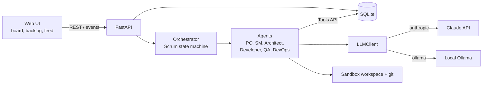
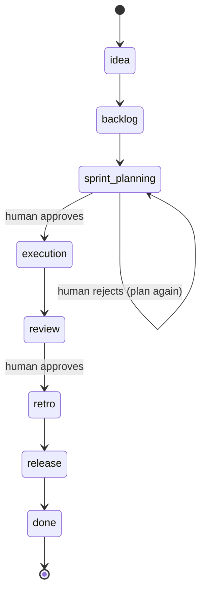
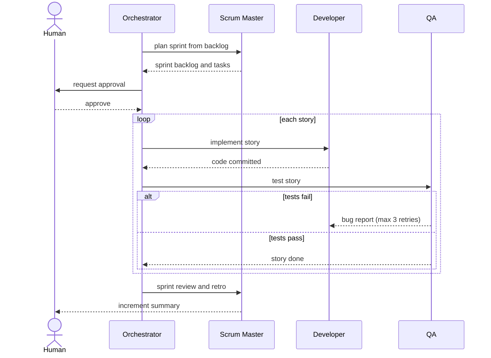
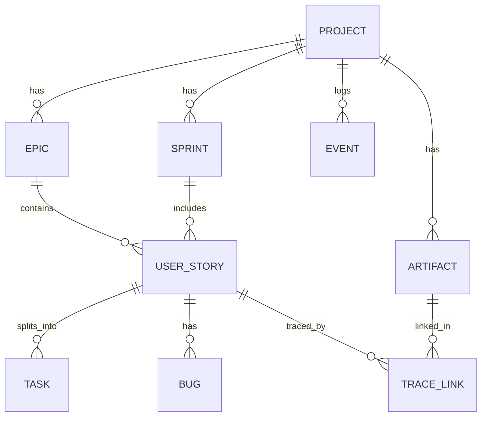

# Scrum Agents Workbench

[](https://github.com/Muniya-64bit/scrum-agents-workbench/actions/workflows/ci.yml)


A multi-agent **CASE workbench for Scrum**. You give it a product idea; a team of LLM agents,
each playing a Scrum role, takes it through the software development life cycle in sprints and
produces real artifacts: backlog, design, code, tests and a release. A human approves the key
ceremonies.

> **Status:** All six agents are implemented and run end to end (idea to release, several sprints)
> with a REST API, a web UI, GQM metrics, traceability, a retrospective that changes the process,
> a scripted offline demo and a CI coverage gate. Live runs have used a local model through Ollama;
> the pipeline completes, but a 14B model delivers only part of a small backlog (see
> [Live results](#live-results)). The Claude API path has not been run end to end. Open work is
> tracked in the [issues](https://github.com/Muniya-64bit/scrum-agents-workbench/issues).

## Contents
- [Features](#features)
- [How it works](#how-it-works)
- [Quickstart](#quickstart)
- [Configuration](#configuration)
- [API](#api)
- [Project structure](#project-structure)
- [Developing an agent](#developing-an-agent)
- [Demo](#demo)
- [Testing and linting](#testing-and-linting)
- [Live results](#live-results)
- [Roadmap](#roadmap)
- [Team and workflow](#team-and-workflow)
- [Documentation](#documentation)

## Features
- Six role-based agents: Product Owner, Scrum Master, Architect, Developer, QA, DevOps
- Scrum state machine with human approval gates at sprint planning and sprint review; rejecting
  a sprint plan has it planned again with your reason
- Explicit process model (roles, product flow, entry/exit criteria, RACI) that drives the
  orchestrator and generates the [process handbook](docs/process-handbook.md)
- Non-functional requirements with measurable targets, and a rule-based backlog quality check
- **Runs on the Claude API or a local model** (Ollama), with a model per agent role
- **A structured API contract**: the Architect's endpoints per story are read by the Developer and
  QA, and QA checks the code against them
- **Guards on model-written work**: code that drops endpoints or cannot run is refused and retried,
  QA corrects a test that is itself wrong, and every test run starts from a fresh database
- **Planner rules** that keep a sprint moving: stuck stories are parked, spare capacity is filled,
  a capacity cut is limited, and only the agents that close tasks are given tasks
- Traceability matrix story → design → code → tests with an artifact viewer, and every sprint a
  story was planned into
- **Results page**: a verdict first, every sprint side by side, what the team did, quality, cost,
  releases and a Plan-Do-Check-Act view of the improvement
- Retrospective levers that change the next sprint, and a versioned release per sprint
- Schema-validated agent output with retries, response caching and token usage logging
- Mock mode (`MOCK_LLM=1`) so development and tests cost no tokens, plus record/replay of LLM
  answers keyed by meaning (`LLM_MODE`)
- A scripted demo that plays three sprints offline, and a Playwright tour that records it as a video
- Append-only event log that feeds the activity feed

## How it works

### System architecture


### Agents and the SDLC
| Agent | Scrum role | SDLC phase | Outputs |
|---|---|---|---|
| Product Owner | PO | Requirements | Vision, epics, user stories, acceptance criteria |
| Scrum Master | SM | Planning, process | Sprint plan, stand-ups, burndown, retrospective |
| Architect | Dev team | Design | Architecture, API spec, Mermaid/UML diagrams |
| Developer | Dev team | Implementation | Code committed per story |
| QA | Dev team | Testing | Tests from acceptance criteria, bug reports |
| DevOps | Dev team | Deploy | Dockerfile, CI workflow, release notes |

### Scrum state machine
Phases marked with a gate pause until a human approves.


### How the team improves each sprint
The retrospective turns the sprint's measured results into typed process changes: the next
capacity, the fix-retry limit, test-first and working agreements. Unfinished stories go back to the
backlog. The next sprint is planned with those levers and records the process it used, and every
sprint ends with a tagged release (`v0.1.0`, `v0.2.0`, ...). After a release the orchestrator plans
another sprint while stories remain (at most `MAX_SPRINTS`). The Metrics page shows each sprint as
a Plan-Do-Check-Act card, so you can see sprint 2 improve on sprint 1. See
[docs/agents.md](docs/agents.md) and [docs/metrics.md](docs/metrics.md).

### One sprint, step by step


### Data model


## Quickstart
Requires Python 3.12 and `make`.

```bash
git clone https://github.com/Muniya-64bit/scrum-agents-workbench.git
cd scrum-agents-workbench
make setup    # virtualenv, dependencies, .env (mock mode, no API key needed)
make test     # all tests should pass
make run      # API at http://localhost:8000, interactive docs at /docs
```

Try the flow with curl:
```bash
curl -X POST localhost:8000/projects -H 'content-type: application/json' \
  -d '{"name":"Todo","idea":"A simple to-do app"}'
curl -X POST localhost:8000/projects/1/advance      # repeat to move through phases
curl -X POST localhost:8000/projects/1/approve      # at a gate
curl localhost:8000/projects/1/events
```

To use the real model, set `ANTHROPIC_API_KEY` and `MOCK_LLM=0` in `.env`.

### Local model with Ollama
No API key or cloud account is needed. Install [Ollama](https://ollama.com), pull a model and set
these in `.env`:
```bash
ollama pull qwen2.5:14b          # about 9 GB; use qwen2.5:7b on a smaller GPU
ollama pull qwen2.5-coder:14b    # optional: a code model for the Developer and QA
```
```
MOCK_LLM=0
LLM_PROVIDER=ollama
WORKBENCH_MODEL=qwen2.5:14b
WORKBENCH_MODEL_DEVELOPER=qwen2.5-coder:14b
WORKBENCH_MODEL_QA=qwen2.5-coder:14b
LLM_PRICE_INPUT_PER_MTOK=0
LLM_PRICE_OUTPUT_PER_MTOK=0
```
- The client sends each agent's JSON schema to Ollama as `format`, so the model can only answer in
  the shape the agent expects.
- `WORKBENCH_MODEL_<ROLE>` gives one agent its own model, so a code model can write the code and
  the tests while a general model does the rest.
- Calls are slow compared with the Claude API: a phase takes minutes, and a whole project with
  three sprints took from 4 to 16 minutes on a 16 GB GPU.
- Models under about 7B parameters often fail the schemas.
- Start the API with `make run`, which reloads only when `workbench/` changes. A plain
  `uvicorn --reload` also watches `workspaces/`, where the agents write code, and restarts the API
  in the middle of a phase.

### Web UI
Requires Node.js 22. Keep `make run` going in one terminal, then in another:
```bash
make ui-setup   # npm ci in frontend/
make seed       # optional: a demo project with a backlog and a sprint board
make ui         # http://localhost:5173
```
The UI has a project list, the backlog, a Kanban sprint board, a live agent activity feed, an
approval inbox, a traceability matrix and a Results page. At a gate, the approval card on every
page lists each story with its acceptance criteria and tasks, so you see what you accept. See
[docs/frontend.md](docs/frontend.md).

## Configuration
Set in `.env` (copy from `.env.example`).

| Variable | Default | Purpose |
|---|---|---|
| `ANTHROPIC_API_KEY` | empty | Claude API key, needed when `MOCK_LLM=0` |
| `WORKBENCH_MODEL` | `claude-sonnet-5-5` | Model used by all agents |
| `MOCK_LLM` | `1` | `1` returns canned output with no API calls (used when `LLM_MODE` is unset) |
| `LLM_MODE` | from `MOCK_LLM` | `mock`, `live`, `record` or `replay` ([docs/development.md](docs/development.md#llm-modes)) |
| `LLM_SCENARIO_DIR`, `LLM_REPLAY_FALLBACK` | empty, `error` | Scenario folder for record/replay; `mock` uses the mock answer when a recording is missing |
| `DEFAULT_CAPACITY`, `DEFAULT_MAX_FIX_RETRIES`, `MAX_SPRINTS` | `10`, `3`, `3` | First sprint's points, Developer attempts per bug, sprints before the project ends |
| `WORKBENCH_MODEL_<ROLE>` | `WORKBENCH_MODEL` | Model of one role, e.g. `WORKBENCH_MODEL_DEVELOPER`, `WORKBENCH_MODEL_QA` (roles: `PRODUCT_OWNER`, `SCRUM_MASTER`, `ARCHITECT`, `DEVELOPER`, `QA`, `DEVOPS`) |
| `LLM_PROVIDER` | `anthropic` | Live backend: `anthropic` or `ollama` (local) |
| `OLLAMA_URL`, `OLLAMA_NUM_CTX`, `OLLAMA_TIMEOUT` | `http://localhost:11434`, `16384`, `1800` | Ollama server, context window in tokens, seconds per answer |
| `LLM_PRICE_INPUT_PER_MTOK`, `LLM_PRICE_OUTPUT_PER_MTOK` | `2.0`, `10.0` | USD per million tokens for the cost estimate |
| `DATABASE_URL` | `sqlite:///./workbench.db` | Database connection string |
| `WORKSPACES_DIR` | `./workspaces` | Where generated project code is written |

## API
| Method | Path | Description |
|---|---|---|
| GET | `/health` | Liveness check |
| POST | `/projects` | Create a project from `{name, idea}` |
| GET | `/projects/{id}` | Current phase and approval state |
| POST | `/projects/{id}/advance` | Run the next phase (409 while awaiting approval) |
| POST | `/projects/{id}/approve` | Clear a human gate |
| GET | `/projects/{id}/events?after=<id>` | Activity feed |
| GET | `/projects/{id}/stream` | Live activity feed (Server-Sent Events) |
| GET | `/projects/{id}/backlog` | Epics and stories |
| GET | `/projects/{id}/sprints`, `/sprints/{id}` | Sprints with stories and tasks |
| GET / PATCH | `/projects/{id}/tasks`, `/tasks/{id}` | List tasks, move a task on the board |
| GET | `/projects/{id}/artifacts`, `/artifacts/{id}` | Design, code, test and release artifacts |
| GET | `/projects/{id}/bugs` | Bugs from QA |
| GET | `/projects/{id}/traceability` | Story -> design -> code -> test -> release |
| GET | `/projects/{id}/releases` | Versioned release per sprint |
| GET | `/projects/{id}/process` | Process levers now and for the next sprint |
| GET | `/process/model` | Process model: roles, product flow, entry/exit criteria, RACI |
| GET | `/projects/{id}/metrics`, `/sprints/{id}/burndown` | GQM metrics, burndown series |
| GET | `/projects/{id}/improvement` | One Plan-Do-Check-Act row per sprint |

Full reference with examples: [docs/api.md](docs/api.md).

## Project structure
```
workbench/
  api/            FastAPI app, response models, the event stream
  agents/         BaseAgent, Tools API, registry (one module per real agent)
  db/             SQLAlchemy models, session, repository helpers
  llm/            LLMClient: providers, validation, retries, cache, mock / record / replay modes
  orchestrator/   Scrum state machine
  process_model.py  The process as data: roles, flow, entry and exit criteria, RACI
  process.py      Sprint levers (capacity, fix retries, test-first) and the retro advisor
  contract.py     The Architect's API contract: render, parse, check the code against it
  staticcheck.py  Undefined names and syntax errors in model-written code
  workspace.py    One sandbox directory and git repository per project
  runner.py       Runs the generated project's tests on a fresh database
  requirements.py Non-functional requirements and the backlog quality check
  metrics.py      GQM metrics, burndown and traceability, from the event log
  schemas.py      Shared agent output contracts
tests/            pytest suite
docs/             Architecture, Scrum process evidence, reference
frontend/         Web UI (React + Vite)
scripts/          Demo runner (demo.py), scenario key lister, seed and sample scripts
demo/scenarios/   Scripted demo scenarios (LLM answers as JSON)
```

## Developing an agent
Subclass `BaseAgent`, register it in `workbench/agents/registry.py`, and test it in mock mode.
The full guide with a worked example is in [docs/agents.md](docs/agents.md).

## Demo
A scripted scenario plays a whole project (three sprints, a caught bug, a carried-over story, a
retrospective that changes the process, three tagged releases) offline and at no cost. The LLM
answers are hand-written; everything else is real.

```bash
python scripts/demo.py run --scenario todo-app --fresh      # terminal, about 15 seconds
python scripts/demo.py serve --scenario todo-app --fresh    # API for the UI (npm run dev in frontend/)
```
See [docs/demo.md](docs/demo.md).

## Testing and linting
```bash
make test    # pytest
make cov     # pytest with the coverage gate (total line coverage must stay at 95% or more)
make lint    # ruff
```
CI runs lint, the tests with the coverage gate (`--cov-fail-under=95`) and the frontend checks on
every pull request. There are about 360 backend tests and 160 front-end tests, and coverage is
about 99% of `workbench/` today.

## Live results
What the pipeline delivers depends on the model. These are runs of the same project (a library
lending API, a backlog of 6 stories and 19 points) on a local 14B model through Ollama, a code model
for the Developer and QA and a general model for the rest. The runs below all reached the end (idea
to release); the table is how much of the backlog passed its tests.

| State of the system | Stories done | Points delivered |
|---|---|---|
| Before the guards and the planner fixes | 0 of 6 | 0 |
| Tasks assigned only to the agents that close them | 1 of 6 | 5 |
| Latest runs (QA corrects wrong tests, stuck stories parked, fresh database) | 1 to 2 of 6 | 3 to 5 |

Points did not climb steadily: run-to-run variation is large, and three or four runs cannot
separate a real change from noise. What changed is how the team behaves: later sprints keep testing
and fixing instead of idling, five of six stories are now attempted (two before), and a story with a
wrong test can finish. The bugs that remain are mostly the Developer and QA disagreeing on what a
request looks like. The scripted demo above is hand-written and shows the process, not a model's
output. How the checks work is in [docs/architecture.md](docs/architecture.md).

## Roadmap
Three one-day sprints. See the issue labels `day-1`, `day-2` and `day-3`.

```mermaid
gantt
  dateFormat X
  axisFormat Day %s
  section Day 1: foundation
  Tooling, schema, LLM wrapper, orchestrator :0, 1
  section Day 2: build
  Agents, API, UI                            :1, 2
  section Day 3: finish
  Integration, metrics, tests, report        :2, 3
```



## Team and workflow
Work is split into six workstreams, labelled `ws1` to `ws6` on each issue: orchestrator,
PO and SM agents, Architect and Developer agents, QA and DevOps agents, backend and data,
and frontend. Branch from `main` as `feat/<issue>-name`, open a pull request that references
the issue, and get one review. See [CONTRIBUTING.md](CONTRIBUTING.md). Our own stand-ups and
retrospectives are in [docs/scrum](docs/scrum).

## Documentation
| Document | Contents |
|---|---|
| [docs/architecture.md](docs/architecture.md) | Components, state machine, data model, design decisions |
| [docs/development.md](docs/development.md) | Setup, workflow, conventions, troubleshooting |
| [docs/agents.md](docs/agents.md) | How to build an agent |
| [docs/api.md](docs/api.md) | REST API reference |
| [docs/frontend.md](docs/frontend.md) | Web UI: running it, structure, design tokens |
| [docs/demo.md](docs/demo.md) | Run the scripted demo, write a scenario, record a real run |
| [docs/metrics.md](docs/metrics.md) | GQM goals, questions and metrics, how they are computed, limits |
| [docs/process-handbook.md](docs/process-handbook.md) | The team's process: activities, product flow, RACI, entry/exit criteria, templates |
| [docs/scrum](docs/scrum/README.md) | Our stand-ups and retrospectives |

## License
No license has been chosen yet. Until one is added, all rights are reserved by the authors.
