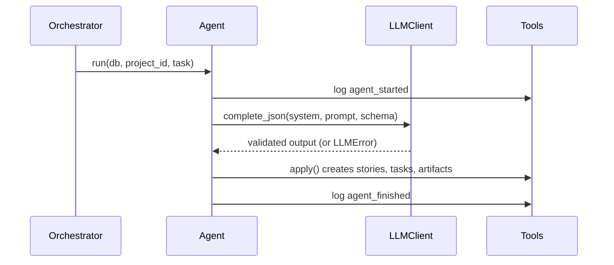

# Building agents

Every agent subclasses `BaseAgent` (`workbench/agents/base.py`). The base class handles logging,
the LLM call, validation and retries. You supply the prompt, the output schema and how to save
the result.

## Agent contract
| Member | Required | Purpose |
|---|---|---|
| `role` | yes | One of `product_owner`, `scrum_master`, `architect`, `developer`, `qa`, `devops` |
| `system_prompt` | yes | The agent's persona and rules |
| `output_schema` | yes | Pydantic model the LLM output must match (add new ones to `workbench/schemas.py`) |
| `build_prompt(db, project_id, task)` | yes | Read project state with `repo` and return the user prompt |
| `mock_output(db, project_id, task)` | yes | A valid canned dict, used when `MOCK_LLM=1` |
| `apply(tools, out, task)` | yes | Save the validated output using `Tools` only |

## Lifecycle of `run()`


## Example
```python
from workbench.agents.base import BaseAgent
from workbench.schemas import BacklogOutput


class ProductOwnerAgent(BaseAgent):
    role = "product_owner"
    system_prompt = "You are a Scrum Product Owner. Turn ideas into epics and user stories."
    output_schema = BacklogOutput

    def build_prompt(self, db, project_id, task):
        project = db.get(Project, project_id)  # from workbench.db.models
        return f"Product idea: {project.idea}"

    def mock_output(self, db, project_id, task):
        return {"vision": "v", "epics": [{"title": "Auth", "stories": []}]}

    def apply(self, tools, out, task):
        for epic in out.epics:
            e = tools.create_epic(epic.title, epic.description)
            for story in epic.stories:
                tools.create_story(e.id, **story.model_dump())
```

Register it in `workbench/agents/registry.py`:
```python
AGENTS["product_owner"] = ProductOwnerAgent()
```

## Tools API
| Method | Effect |
|---|---|
| `create_epic(title, description)` | New epic |
| `create_story(epic_id, **fields)` | New user story |
| `create_task(story_id, title, assignee)` | New task |
| `update_task(task_id, status)` | `todo`, `doing`, `testing` or `done` |
| `write_artifact(kind, name, content, story_id, path, version)` | Save an artifact and link it to a story |
| `report_bug(story_id, description)` | Open a bug for a story |
| `record_fix_attempt(bug_id, fixed)` | Count a Developer fix attempt; `fixed` marks the bug fixed |
| `reopen_bug(bug_id)` | QA re-tested a bug the Developer called fixed and it still fails |
| `verify_bug(bug_id)` | QA re-tested the story and the bug no longer reproduces |
| `log(kind, message, **payload)` | Add a custom event |

## Testing an agent
Tests run in mock mode. Copy the pattern from `tests/test_core.py`:
```python
def test_po_creates_backlog(db):
    p = repo.create_project(db, "x", "y")
    ProductOwnerAgent().run(db, p.id)
    assert repo.backlog(db, p.id)
```

## Guidelines
- Keep prompts in the agent file, next to the code that uses them.
- Never write to the database directly; use `Tools` so the event log stays complete.
- Keep the output schema small. Smaller schemas fail validation less often.
- Real runs are cached in `.cache/llm/`. Delete that folder to force fresh calls.

## Developer
`DeveloperAgent` (`workbench/agents/developer.py`) runs in the execution phase and writes code into
the project's sandbox workspace (`workbench/workspace.py`): a folder with its own git repository at
`$WORKSPACES_DIR/project-<id>`.

- **Which stories:** sprint stories that have no `code` artifact yet, plus coded stories with open
  bugs. `task["story_id"]` forces a single story, which is how QA asks for a rerun.
- **One LLM call and one commit per story.** The prompt has the story, its acceptance criteria,
  the architecture overview, the story's design notes, open bugs and the current files. The
  commit message references the story: `Story #3: Create an item` or
  `Fix bug #7 in story #3: Create an item`.
- **Output** is `CodeOutput`: full content of each changed file. Each changed file becomes a `code`
  artifact traced to the story, with `version` counting changes to that path. The developer's
  tasks move `todo` -> `doing` -> `done`.
- **Unsafe paths** (absolute, `..`, `.git`) are not written; each gets a `file_rejected` event.
- **Bug fixes:** every attempt increments `Bug.retries`. A commit marks the bug `fixed`; QA reopens
  it if the tests still fail. With no change the bug stays open (`bug_fix_failed`). After
  `MAX_FIX_RETRIES` (3) attempts the bug is skipped with a `bug_retry_limit` event.
- With nothing to build, no LLM call is made (`code_skipped` event).
- Tests use an autouse fixture in `tests/conftest.py` that points `WORKSPACES_DIR` at a temp dir.

## QA agent
`QAAgent` (`workbench/agents/qa.py`) runs after the Developer in the execution phase. For each
sprint story that has code it:

1. asks the LLM for pytest files under `tests/` (one test per acceptance criterion), commits them
   to the workspace and saves them as `test` artifacts traced to the story. Files outside
   `tests/` are rejected.
2. runs them with `workbench/runner.py`: a pytest subprocess in the workspace with a 120 second
   limit and no `ANTHROPIC_API_KEY` in its environment. The workspace is a plain directory, not a
   container, so this guards against accidents rather than hostile code.
3. files one `Bug` per failing test (no duplicates), and sets QA tasks to `testing` or `done`.
4. while bugs are open and have attempts left, calls the Developer with `{"story_id": id}` and
   tests again. The limit is `MAX_FIX_RETRIES` (3) attempts per bug. A bug the Developer marked
   fixed that still fails is reopened; after the limit it stays open for a human.

Every run logs a `test_run` event (`passed`, `failed`, `ok`) for the metrics views.
`QAAgent(developer=None)` only reports bugs and never reruns the Developer.

## DevOps agent
`DevOpsAgent` (`workbench/agents/devops.py`) runs in the release phase after QA and the review
gate. It uses the same per-project `Workspace` as Developer and QA.

- It generates exactly `Dockerfile`, `.github/workflows/ci.yml` and `RELEASE_NOTES.md`; any other
  LLM-supplied path is rejected.
- Release notes contain only stories whose tasks are all `done`, so a story is not released until
  both its Developer and QA work has completed.
- Changed files become `release` artifacts and are committed together as `Prepare release`.
- In real-model mode, Docker is built when available. Mock-mode runs skip the external build so
  tests remain deterministic. Success, failure and skipped builds are recorded as events.
