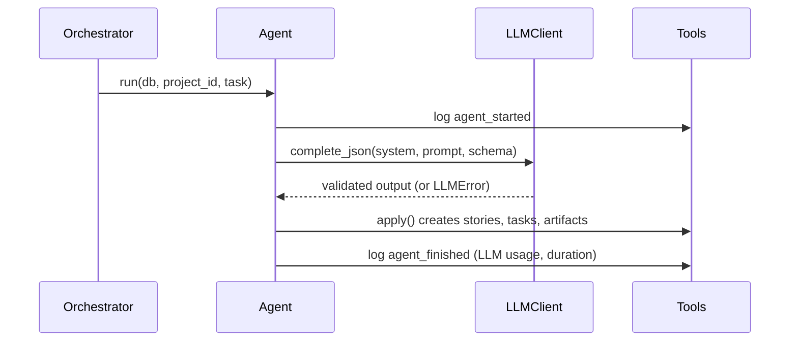
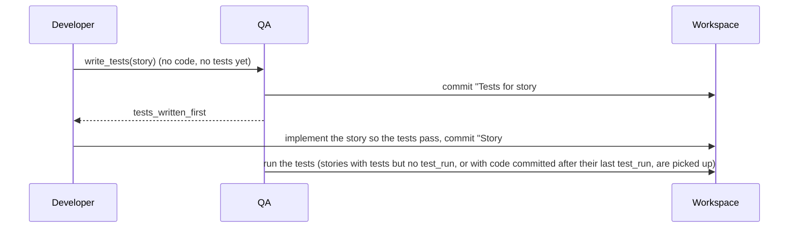

# Building agents

Every agent subclasses `BaseAgent` (`workbench/agents/base.py`). The base class handles logging,
the LLM call, validation and retries. You supply the prompt, the output schema and how to save
the result.

## Agent contract
| Member | Required | Purpose |
|---|---|---|
| `role` | yes | One of `product_owner`, `scrum_master`, `architect`, `developer`, `qa`, `devops` |
| `system_prompt` | yes | The agent's persona and rules |
| `output_schema` | yes | Pydantic model the LLM output must match (add new ones to `workbench/schemas.py`) |
| `build_prompt(db, project_id, task)` | yes | Read project state with `repo` and return the user prompt |
| `mock_output(db, project_id, task)` | yes | A valid canned dict, used when `MOCK_LLM=1` |
| `apply(tools, out, task)` | yes | Save the validated output using `Tools` only |
| `llm_key(db, project_id, task)` | no | Name of the LLM call for record/replay (see below); the default is right for almost every agent |

## Lifecycle of `run()`


**Working agreements.** Before the LLM call, `BaseAgent.run` appends the team's working
agreements to the prompt when the process has any (Product Owner excluded: it runs before any
retrospective). The block is the last thing in the prompt:

```
Team working agreements (from the last retrospective):
- Write the acceptance tests first and make them pass before committing
```

The agreements come from `process.effective_process(db, project_id, task["phase"])`: in sprint
planning the process the retro just decided, in every other phase the sprint's own process.

## What `run()` logs
`agent_started`, then `agent_finished` with the usage of this run, so the cost and speed of the
process can be measured (see [metrics.md](metrics.md)):

| Payload key | Meaning |
|---|---|
| `calls`, `input_tokens`, `output_tokens` | Model API calls and tokens of this run (0 in mock mode and on cache hits) |
| `cache_hits`, `invalid_outputs` | Answers served from `.cache/llm/`; answers that failed schema validation and were retried |
| `duration_ms`, `model`, `llm_mode` | Wall-clock time; model name; `mock`, `live`, `record` or `replay` (`none` for the release step, which makes no LLM call) |
| `story_id` | `task["story_id"]` when the run was for one story, else `null` |

Other payload keys added for the metrics: `task_created` has `story_id` and `assignee`;
`task_updated` has `status` and `story_id`; `bug_reported` has `story_id`. The Scrum Master logs
`sprint_planned` (`sprint_id`, `number`, `story_ids`, `committed_points`, `capacity`) after
planning; it marks the start of a sprint for the metrics.

## Call keys (record and replay)
`BaseAgent.run` names every LLM call with `llm_key`:
`<role>.<class>.<phase>.s<sprint>[.<story slug>]`, for example
`developer.DeveloperAgent.execution.s1.create-item` or `scrum_master.RetroAgent.retro.s2`. The
sprint is `task["sprint_number"]`, else the current sprint's number, else 0; the story slug is the
lowercase title with other characters turned into `-`, at most 40 characters. A key that repeats
(a bug fix after the first build of the same story) gets a counter: `...create-item.1.json`,
`...create-item.2.json`.

Keys describe what the call is for, not what the prompt says. Recordings therefore survive
prompt edits and refactors; if the prompt changed, `run` logs `llm_replay_drift` (`key`, `n`) and
still serves the recorded answer. If no recording exists and `LLM_REPLAY_FALLBACK=mock`, `run`
logs `llm_replay_fallback`. A new agent needs no extra code: the class name is part of the key.
See [development.md](development.md#llm-modes).

## Example
```python
from workbench.agents.base import BaseAgent
from workbench.schemas import BacklogOutput


class ProductOwnerAgent(BaseAgent):
    role = "product_owner"
    system_prompt = "You are a Scrum Product Owner. Turn ideas into epics and user stories."
    output_schema = BacklogOutput

    def build_prompt(self, db, project_id, task):
        project = db.get(Project, project_id)  # from workbench.db.models
        return f"Product idea: {project.idea}"

    def mock_output(self, db, project_id, task):
        return {"vision": "v", "epics": [{"title": "Auth", "stories": []}]}

    def apply(self, tools, out, task):
        for epic in out.epics:
            e = tools.create_epic(epic.title, epic.description)
            for story in epic.stories:
                tools.create_story(e.id, **story.model_dump())
```

Register it in `workbench/agents/registry.py`:
```python
AGENTS["product_owner"] = ProductOwnerAgent()
```

## Tools API
| Method | Effect |
|---|---|
| `create_epic(title, description)` | New epic |
| `create_story(epic_id, **fields)` | New user story |
| `set_vision(vision)` | Save the product vision on the project |
| `create_sprint(goal, capacity)` | New active sprint, numbered automatically |
| `add_story_to_sprint(sprint_id, story_id)` | Move a story into a sprint |
| `snapshot_burndown(sprint_id)` | Record points remaining (feeds the burndown data) |
| `unplan_story(story_id, from_sprint_id)` | Return an unfinished story to the backlog (event `story_carried_over`) |
| `save_retro(sprint_id, retro)` | Store went well / went wrong / actions / process changes / metrics and close the sprint |
| `create_task(story_id, title, assignee)` | New task |
| `update_task(task_id, status)` | `todo`, `doing`, `testing` or `done` |
| `write_artifact(kind, name, content, story_id, path, version)` | Save an artifact and link it to a story |
| `report_bug(story_id, description)` | Open a bug for a story |
| `record_fix_attempt(bug_id, fixed)` | Count a Developer fix attempt; `fixed` marks the bug fixed |
| `reopen_bug(bug_id)` | QA re-tested a bug the Developer called fixed and it still fails |
| `verify_bug(bug_id)` | QA re-tested the story and the bug no longer reproduces |
| `message(to, subject, body, **payload)` | Tell another agent something, as an `agent_message` event (see "Messages between agents") |
| `refine_story(story_id, **fields)` | Change fields of a backlog story; logs `story_refined` with `{field: [old, new]}`, returns `None` when nothing changed |
| `reset_bug_attempts(story_id)` | Give the open bugs of a story a fresh set of fix attempts (`bug_attempts_reset`) |
| `log(kind, message, **payload)` | Add a custom event |

## Testing an agent
Tests run in mock mode. Copy the pattern from `tests/test_core.py`:
```python
def test_po_creates_backlog(db):
    p = repo.create_project(db, "x", "y")
    ProductOwnerAgent().run(db, p.id)
    assert repo.backlog(db, p.id)
```

## Guidelines
- Keep prompts in the agent file, next to the code that uses them.
- Never write to the database directly; use `Tools` so the event log stays complete.
- Keep the output schema small. Smaller schemas fail validation less often.
- Real runs are cached in `.cache/llm/`. Delete that folder to force fresh calls.

## Developer
`DeveloperAgent` (`workbench/agents/developer.py`) runs in the execution phase and writes code into
the project's sandbox workspace (`workbench/workspace.py`): a folder with its own git repository at
`$WORKSPACES_DIR/project-<id>`.

- **Which stories:** sprint stories that have no `code` artifact yet, plus coded stories with open
  bugs. `task["story_id"]` forces a single story, which is how QA asks for a rerun.
- **One LLM call and one commit per story.** The prompt has the story, its acceptance criteria,
  the architecture overview, the story's design notes, open bugs and the current files. The
  commit message references the story: `Story #3: Create an item` or
  `Fix bug #7 in story #3: Create an item`.
- **Output** is `CodeOutput`: full content of each changed file. Each changed file becomes a `code`
  artifact traced to the story, with `version` counting changes to that path. The developer's
  tasks move `todo` -> `doing` -> `done`.
- **Unsafe paths** (absolute, `..`, `.git`) are not written; each gets a `file_rejected` event.
- **Bug fixes:** every attempt increments `Bug.retries`. A commit marks the bug `fixed`; QA reopens
  it if the tests still fail. With no change the bug stays open (`bug_fix_failed`). After
  the sprint's `max_fix_retries` attempts (`MAX_FIX_RETRIES`, 3, when the process does not say
  otherwise) the bug is skipped with a `bug_retry_limit` event. The limit is resolved once per run
  from `task["max_fix_retries"]`, else `process.effective_process(...)`; QA passes its value on.
- **Test-first.** When the sprint's process has `test_first` on and the story has no code and no
  tests, the Developer first calls `self.test_writer` (set by `QAAgent`), then builds the story.
  The prompt gains "Tests you must make pass (do not edit them):" with the latest test files,
  outside the file budget.
- With nothing to build, no LLM call is made (`code_skipped` event).
- Tests use an autouse fixture in `tests/conftest.py` that points `WORKSPACES_DIR` at a temp dir.

## QA agent
`QAAgent` (`workbench/agents/qa.py`) runs after the Developer in the execution phase. For each
sprint story that has code it:

1. asks the LLM for pytest files under `tests/` (one test per acceptance criterion), commits them
   to the workspace and saves them as `test` artifacts traced to the story. Files outside
   `tests/` are rejected.
2. runs them with `workbench/runner.py`: a pytest subprocess in the workspace with a 120 second
   limit and no `ANTHROPIC_API_KEY` in its environment. The workspace is a plain directory, not a
   container, so this guards against accidents rather than hostile code.
3. checks the code against the Architect's API contract (see below) and counts a missing endpoint
   or a wrong success status as a failure named `contract <METHOD> <path>`.
4. files one `Bug` per failing test or contract failure (no duplicates), and sets QA tasks to
   `testing` or `done`. A failure caused by the test code itself (a `NameError`, an import error,
   a collection error) is not a bug in the application: QA rewrites its own tests from the
   failing output (`tests_revised`) and runs again. If the rewrite changes nothing the loop stops.
5. while bugs are open and have attempts left, calls the Developer with `{"story_id": id,
   "max_fix_retries": n}` and tests again. The limit is the sprint's `max_fix_retries`
   (`MAX_FIX_RETRIES`, 3, by default) attempts per bug. A bug the Developer marked fixed that
   still fails is reopened; after the limit it stays open for a human.

### Getting unstuck
A live run had one story that could not pass. It took sprints 2 and 3, the retrospective halved the
capacity, and four of six stories were never started. Four rules keep the team moving:

- **QA corrects a wrong test.** When the Developer has failed twice on a test that runs (not a
  crash), QA reviews the test once per run against the API contract. A test is wrong when it
  asserts something the contract does not promise (the exact text of an error message, a status
  or a field it does not name). A corrected test (`tests_corrected`) gives the bug a fresh set of
  attempts; a right test is returned unchanged (`tests_review_unchanged`).
- **A stuck story is parked.** A story carried over twice with a bug still open is *blocked*: the
  planner plans it after other work and marks it `(blocked)` in the prompt.
- **Spare capacity is filled.** After the model's picks (blocked stories removed) the sprint is
  topped up by priority until the capacity is full, and blocked stories are added only if room is
  left. A sprint whose plan the human rejected is not topped up.
- **A capacity cut is gentle.** One retrospective may lower the capacity by at most 30%.
- **Fresh attempts.** A carried-over story gets its fix attempts reset when it is planned again
  (`bug_attempts_reset`). The Developer's prompt says how many earlier attempts failed and asks
  for a different approach, so a reset does not repeat the same answer.

### A fresh database for every test run
The generated app creates its SQLite file when its tests run. A later story that adds a column then
failed with `no such column` against the old file, because `CREATE TABLE IF NOT EXISTS` leaves an
existing table alone. `runner.run_pytest` deletes `*.db`, `*.sqlite` and `*.sqlite3` files in the
workspace before each run, so the database always comes from the current code.

### Tasks nobody can close
A story is done only when all its tasks are done, and only the Developer (on a commit) and QA (when
the tests pass) ever mark a task done. The sprint planner may assign tasks only to `developer` and
`qa`; any other role is mapped to `developer`, and a story without a developer task or without a
QA task gets a default one (`Implement: ...`, `Test: ...`). Live runs once had tasks for the
architect, product owner or devops that stayed `todo` forever, so those stories could never be
completed however good the code was.

### Guards on the Developer's code
- **Tables at import time.** The Developer is told to create SQLite tables with
  `CREATE TABLE IF NOT EXISTS` in a function it also calls at module level. A live run had them
  created only in a startup event, which `TestClient(app)` does not run, so every test failed with
  `no such table`. QA's tests now use `with TestClient(app) as client:`, so startup code runs too.
- **No dropped endpoints.** Before a story's files are written, `contract.lost` compares the
  routes the workspace has with the routes it would have. A rewrite that removes an endpoint (the
  second story overwrote `main.py` without the first story's routes) is not applied: the
  Developer gets one more try with the removed endpoints named in the prompt, and a second refusal
  counts as a failed fix attempt. A route that moved behind a router prefix is not a removal.
  Events: `code_rejected`.

### NUL characters and files that do not compile
A live model once wrote NUL bytes into `app/main.py`. Python refuses such a file, QA only saw its test
fail to import the app (which looks like a mistake of the test), revised its tests, got the same file
back and filed no bug, so nobody fixed the app and two sprints idled. Three rules now stop it:
`Workspace.write` strips NUL characters from everything it writes (the Developer and QA log
`file_cleaned`); `staticcheck.problems` compiles a file first (`syntax_problem`), so a syntax error or
a NUL is caught even when ruff cannot run; and QA checks the `app/*.py` files itself
(`_broken_app_files`): one that does not compile becomes a bug `app code: <file> line N: <message>`
for the Developer, and the test is not revised.

### Modules that are not installed
The Developer's `app/*.py` files are refused when they import a module that is not installed where
the tests run (`staticcheck.missing_modules`: `import validators`, `import pymongo`), unless it is the
standard library or the project's own `app`/`tests` package. The reason names the module and the line
and lists what is installed (fastapi, pydantic, httpx, uvicorn, sqlalchemy, the standard library),
and the Developer gets up to two more tries. Without this a live run lost three sprints to
`ModuleNotFoundError: No module named 'validators'`: the prompt said only what was installed, and the
model kept returning the same import.

### API contract
The Architect's per-story design carries `endpoints`, each with method, path, purpose,
`request_fields`, `success_status` and `error_statuses` (at least one per story). `workbench/contract.py`
renders them as an OpenAPI `paths` artifact `API: <story>` (never empty or free text), and the
Architect sees the endpoints already designed so paths stay consistent. The Developer is told to
implement exactly these methods, paths, JSON field names and status codes. QA writes its tests
against the same contract. `contract.violations` checks the code by rules: the routes found in
`app/*.py` against the contract, ignoring router prefixes. It runs in live mode only, because the mock
Developer writes no routes.

A request body in the contract carries one concrete `example` (`contract.example_body`: `str` is
`"text"`, `int` is `1`, `float` is `1.5`, `bool` is `true`). Both prompts say a request has exactly
the fields of its example, so the Developer and QA stop disagreeing on field names, which was the
cause of most `422` responses where `201` was expected.

Every run logs a `test_run` event (`passed`, `failed`, `ok`) for the metrics views.
`QAAgent(developer=None)` only reports bugs and never reruns the Developer.

**Test-first flow.** `QAAgent.__init__` sets `developer.test_writer = self.write_tests`. With the
`test_first` lever on, the Developer asks QA for the tests before it codes:



In that flow the QA prompt says "There is no implementation yet" and lists the story's design and
API spec instead of the code.

## Backlog refinement
Refinement is a step of the sprint planning phase: `PHASE_AGENTS["sprint_planning"]` is
`product_owner, scrum_master`. `ProductOwnerAgent.run` writes the backlog in the backlog phase and
hands over to `BacklogRefiner` in sprint planning. The refiner looks at the stories that are not in
a sprint, with the problems the rule-based backlog check found in them (`story_problems`), and:

- **calls no model** when there is nothing to fix (`refinement_skipped`), so a clean backlog costs
  nothing;
- otherwise asks for `RefinementOutput`: for each story to change, the whole set of
  `acceptance_criteria` (2 to 4 Given/When/Then strings), `points` (1, 2, 3, 5 or 8) and `priority`;
- **applies only the stories the check flagged**, so the model cannot change a good story or one
  that is already in a sprint. Each change is a `story_refined` event with `{field: [old, new]}`,
  the result is a `backlog_refined` event (problems before and after) and the check is run again
  (`backlog_validated`), which the Backlog page shows.

The mock refiner is deterministic: it keeps the criteria that are already in Given/When/Then form,
adds a generic pair when fewer than two are left, and rounds the points to the scale, at most 8.

## Messages between agents
The agents do not call each other freely. Where they depend on one another they tell each other on
the event bus, and the activity feed shows it as "Told the Developer: ...". `Tools.message(to,
subject, body)` logs an `agent_message` event from the sending agent (`payload.to` is the receiver's
role):

| From | To | When |
|---|---|---|
| Architect | Developer, QA | a story's API contract is published |
| QA | Developer | a bug is filed ("Please fix bug #n"), or QA corrected a test |
| Developer | QA | a fix attempt ended ("a fix is committed" or "I could not fix it") |

These are structured notifications, not free-form chat: nothing is lost, nothing is read back by an
agent, and the call that makes the Developer fix a bug stays a direct call from QA.

## DevOps agent
`DevOpsAgent` (`workbench/agents/devops.py`) runs in the release phase after QA and the review
gate. It uses the same per-project `Workspace` as Developer and QA.

- It generates exactly `Dockerfile`, `.github/workflows/ci.yml` and `RELEASE_NOTES.md`; any other
  LLM-supplied path is rejected.
- Release notes contain only stories whose tasks are all `done`, so a story is not released until
  both its Developer and QA work has completed.
- Changed files become `release` artifacts and are committed together as `Prepare release`.
- In real-model mode, Docker is built when available. Mock-mode runs skip the external build so
  tests remain deterministic. Success, failure and skipped builds are recorded as events.

## Release step
Every sprint ends with a versioned release. The registered `devops` agent is `ReleaseAgent`
(`workbench/agents/release.py`), which wraps the DevOps agent above as its builder:
`AGENTS["devops"] = ReleaseAgent(builder=DevOpsAgent())`. To use another builder, pass any
`BaseAgent`; with `builder=None` only the versioned part runs.

What `ReleaseAgent` adds on top of the DevOps agent, in order:

1. **Version** `v0.<sprint number>.0` for the current sprint.
2. The builder runs (Dockerfile, CI workflow, `RELEASE_NOTES.md`, commit `Prepare release`).
3. **Release notes** from `release_notes(db, project_id, sprint, version, ws)`, built from the
   database and the git history without an LLM, written to `releases/<version>.md` and committed as
   `Release <version>`.
4. **Git tag** `<version>` (annotated) in the sandbox repository.
5. A `release` artifact `Release <version>`, **traced** to every story completed in the sprint
   (relation `release`, shown on the Traceability page), and the event
   `release_created {version, sha, story_ids, artifact_id, sprint_id}`.

The notes have these sections, in order: title and date, `Completed stories`, `Fixed bugs`,
`Known issues`, `Carried over`, `Process used` (the four levers), `Metrics` (velocity, commitment
reliability, first-pass yield, test pass rate) and `Commits` (subjects since the previous version's
tag, or all of them for `v0.1.0`).

- **Idempotent:** a release whose `Release <version>` artifact exists logs `release_exists` and
  changes nothing. With no sprint the step logs `release_skipped`.
- The agent logs `agent_started` / `agent_finished` itself (`llm_mode` is `none`, zero usage) so
  it shows in the activity feed without counting as an LLM call.

### Release checks
When a sprint is released with a real model, `ReleaseAgent` checks the generated app as a whole
(`workbench/release_checks.py`), the way a deployment would. QA tests the stories one by one; these
look at the app. A mock run skips them (the mock Developer's app does not serve the mock contract).

| Check | How | Result |
|---|---|---|
| starts | `uvicorn app.main:app` is started in the workspace and its OpenAPI document is read | `passed` or `failed` with the last lines of the error |
| serves its contract | the endpoints of the sprint's completed stories against the OpenAPI paths (a router prefix is tolerated) | `passed`, `failed` (`not served: GET /loans`) or `skipped` |
| a requirement | the list endpoints are timed (10 requests each) and the p95 is compared with a time limit in the requirement or its measure (`300 ms`, `500 milliseconds`, `2 seconds`) | `met`, `not met`, or `unverified` (no time limit in it, or the app has no list endpoint to time) |
| security scan | `ruff` security rules (`S102 S105 S106 S107 S301 S307 S324 S506 S608`) over `app/*.py`: exec and eval, hard-coded passwords, pickle, unsafe YAML, weak hashes, SQL built from strings | `passed` or `failed` with the first findings |

Each check is a `release_check` event, a section "Release checks" of the release notes and a row of
`GET /projects/{id}/release-checks`; the Results page shows them. A failed check is a finding, not a
veto: the release is made either way.

## Maintenance after the release
A finished project takes a maintenance request: `Orchestrator.request_maintenance(project_id, title,
description, points)` (`POST /projects/{id}/maintenance`). It adds a top-priority story `Fix: <title>`
with two Given/When/Then criteria to a `Maintenance` epic, logs `maintenance_requested` and moves the
project back to `release`, so the next step plans a maintenance sprint like any other: the planner,
the Developer, QA, the review, the retrospective and a new release. `more_sprints` allows it past
`MAX_SPRINTS` while a fix waits, one extra sprint for each request, so a fix that never passes cannot
loop forever.

## Agents that run in several phases
The Scrum Master runs in sprint planning, review and retro, and each needs a different prompt and
output schema. `ScrumMasterAgent` (`workbench/agents/scrum_master.py`) is the one registered agent;
it reads `task["phase"]` and delegates to a handler per phase (`SprintPlanner`, `StandupAgent`,
`RetroAgent`). Use the same pattern for any agent that serves more than one phase.

- **Capacity is enforced in code.** `_select_stories` drops unknown ids and anything over capacity,
  because the LLM only proposes the sprint.
- **Retro feeds the next sprint.** `SprintPlanner.build_prompt` adds the previous sprint's retro
  actions to the prompt, and the retro's typed process changes shape the plan (next section).
- **Burndown** comes from `burndown_snapshot` events written at each stand-up. Read it with
  `repo.burndown(db, sprint)`.

## Retrospective and process levers
The retrospective changes how the next sprint runs, not only what is written in the prompt.
`RetroAgent` returns `RetroOutput` with the usual lists plus `process_changes` (`ProcessChanges`,
`workbench/schemas.py`). Code clamps the values (`workbench/process.py`); the LLM only proposes.

| Lever | Bounds | Default | Effect |
|---|---|---|---|
| `capacity` | 3 to 40 points | `DEFAULT_CAPACITY` (10) | Points the next sprint may commit to (planning) |
| `max_fix_retries` | 1 to 5 | `DEFAULT_MAX_FIX_RETRIES` (3) | Developer attempts per bug before QA leaves it open |
| `test_first` | on / off | off | QA writes the acceptance tests before the Developer codes the story |
| `guidelines` | 5 kept, 200 characters each | none | Working agreements added to every agent's prompt |

- `ProcessConfig` holds the levers. `apply(changes)` returns the new config and a diff such as
  `{"capacity": [10, 7], "test_first": [false, true]}` (only changed levers).
- `suggest_process_changes(metrics, config)` is a rule-based advisor. The mock retro returns its
  result, and the live retro prompt shows it as a suggestion. Rules: completed < committed lowers
  the capacity to the completed points (floor 3); bugs or a first-pass yield below 100% switch
  test-first on and add a working agreement; a bug that hit the retry limit raises the limit by 1.
- The retro saves `Sprint.retro = {went_well, went_wrong, actions, process_changes, metrics}`.
  `metrics` is the `sprint_metrics` dict at retro time. A sprint that already has a retro is not
  reviewed again (event `retro_exists`).
- **Carry-over.** Before saving, every story of the sprint that is not done goes back to the
  backlog with `Tools.unplan_story` (event `story_carried_over {story_id, from_sprint_id}`). The
  next planning lists it as "(carried over)" and keeps its tasks.
- **Next sprint.** `process.next_process(db, project_id)` returns (config, diff, reason): the
  latest sprint's process plus the retro's changes. `SprintPlanner` plans with its capacity unless
  the task carries an explicit `capacity`, and logs
  `sprint_planned {sprint_id, number, story_ids, committed_points, capacity, process,
  process_changes, process_reason}`. When the diff is not empty it also logs
  `process_changed {sprint_id, diff, reason}`. `process` is the process actually used, so the
  metrics and the PDCA view can show it later.

## Architect
`ArchitectAgent` (`workbench/agents/architect.py`) runs in two phases and delegates by
`task["phase"]`:

| Phase | Handler | Output | Artifacts |
|---|---|---|---|
| backlog | `SystemDesigner` | `ArchitectureOutput` | `architecture` overview, three `diagram`s (components, data-model, main-flow) and an `api_spec` (OpenAPI 3 YAML), each traced to every backlog story with relation `architecture` |
| execution | `DesignDelta` | `DesignDeltaOutput` | Per sprint story: `design` notes, optional `diagram` and the `api_spec` contract rendered from its `endpoints`, traced to that story |

- Diagrams are raw Mermaid. The schema rejects text that does not start with a Mermaid diagram
  type, so a bad diagram triggers an LLM retry.
- A story counts as designed once it has a `design` trace link, so later sprints only design new
  stories. With nothing to design, no LLM call is made (`design_skipped` event).
- Story ids the LLM invents are dropped; stories it skips get a `design_missing` event.
- `Tools.link_artifact(artifact_id, story_ids, relation)` traces one artifact to many stories.
