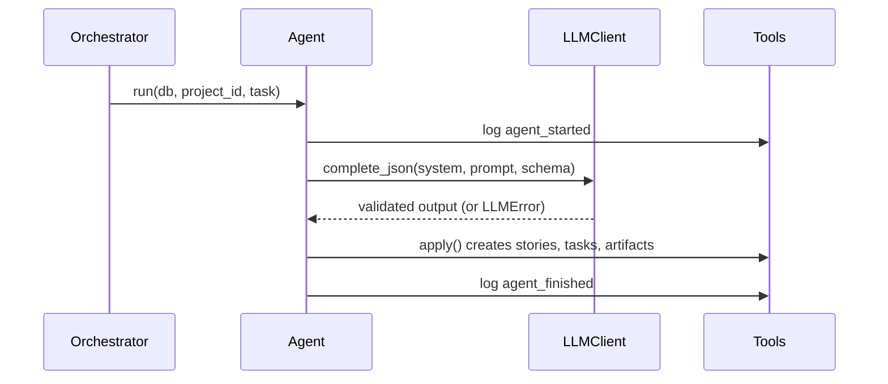

# Building agents

Every agent subclasses `BaseAgent` (`workbench/agents/base.py`). The base class handles logging,
the LLM call, validation and retries. You supply the prompt, the output schema and how to save
the result.

## Agent contract
| Member | Required | Purpose |
|---|---|---|
| `role` | yes | One of `product_owner`, `scrum_master`, `architect`, `developer`, `qa`, `devops` |
| `system_prompt` | yes | The agent's persona and rules |
| `output_schema` | yes | Pydantic model the LLM output must match (add new ones to `workbench/schemas.py`) |
| `build_prompt(db, project_id, task)` | yes | Read project state with `repo` and return the user prompt |
| `mock_output(db, project_id, task)` | yes | A valid canned dict, used when `MOCK_LLM=1` |
| `apply(tools, out, task)` | yes | Save the validated output using `Tools` only |

## Lifecycle of `run()`


## Example
```python
from workbench.agents.base import BaseAgent
from workbench.schemas import BacklogOutput


class ProductOwnerAgent(BaseAgent):
    role = "product_owner"
    system_prompt = "You are a Scrum Product Owner. Turn ideas into epics and user stories."
    output_schema = BacklogOutput

    def build_prompt(self, db, project_id, task):
        project = db.get(Project, project_id)  # from workbench.db.models
        return f"Product idea: {project.idea}"

    def mock_output(self, db, project_id, task):
        return {"vision": "v", "epics": [{"title": "Auth", "stories": []}]}

    def apply(self, tools, out, task):
        for epic in out.epics:
            e = tools.create_epic(epic.title, epic.description)
            for story in epic.stories:
                tools.create_story(e.id, **story.model_dump())
```

Register it in `workbench/agents/registry.py`:
```python
AGENTS["product_owner"] = ProductOwnerAgent()
```

## Tools API
| Method | Effect |
|---|---|
| `create_epic(title, description)` | New epic |
| `create_story(epic_id, **fields)` | New user story |
| `set_vision(vision)` | Save the product vision on the project |
| `create_sprint(goal, capacity)` | New active sprint, numbered automatically |
| `add_story_to_sprint(sprint_id, story_id)` | Move a story into a sprint |
| `snapshot_burndown(sprint_id)` | Record points remaining (feeds the burndown data) |
| `save_retro(sprint_id, retro)` | Store went well / went wrong / actions and close the sprint |
| `create_task(story_id, title, assignee)` | New task |
| `update_task(task_id, status)` | `todo`, `doing`, `testing` or `done` |
| `write_artifact(kind, name, content, story_id, path)` | Save an artifact and link it to a story |
| `report_bug(story_id, description)` | Open a bug for a story |
| `log(kind, message, **payload)` | Add a custom event |

## Testing an agent
Tests run in mock mode. Copy the pattern from `tests/test_core.py`:
```python
def test_po_creates_backlog(db):
    p = repo.create_project(db, "x", "y")
    ProductOwnerAgent().run(db, p.id)
    assert repo.backlog(db, p.id)
```

## Guidelines
- Keep prompts in the agent file, next to the code that uses them.
- Never write to the database directly; use `Tools` so the event log stays complete.
- Keep the output schema small. Smaller schemas fail validation less often.
- Real runs are cached in `.cache/llm/`. Delete that folder to force fresh calls.

## Agents that run in several phases
The Scrum Master runs in sprint planning, review and retro, and each needs a different prompt and
output schema. `ScrumMasterAgent` (`workbench/agents/scrum_master.py`) is the one registered agent;
it reads `task["phase"]` and delegates to a handler per phase (`SprintPlanner`, `StandupAgent`,
`RetroAgent`). Use the same pattern for any agent that serves more than one phase.

- **Capacity is enforced in code.** `_select_stories` drops unknown ids and anything over capacity,
  because the LLM only proposes the sprint.
- **Retro feeds the next sprint.** `SprintPlanner.build_prompt` adds the previous sprint's retro
  actions to the prompt.
- **Burndown** comes from `burndown_snapshot` events written at each stand-up. Read it with
  `repo.burndown(db, sprint)`.
