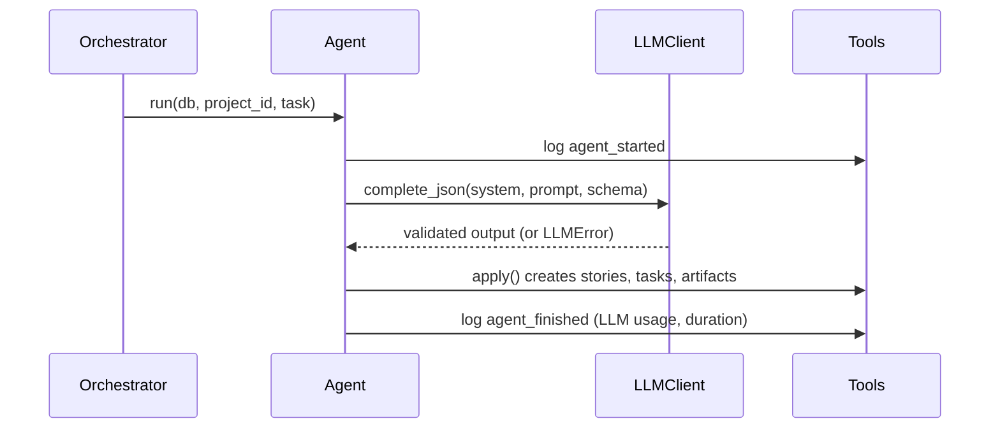
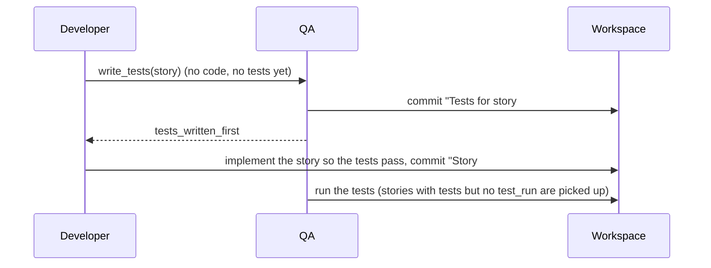

# Building agents

Every agent subclasses `BaseAgent` (`workbench/agents/base.py`). The base class handles logging,
the LLM call, validation and retries. You supply the prompt, the output schema and how to save
the result.

## Agent contract
| Member | Required | Purpose |
|---|---|---|
| `role` | yes | One of `product_owner`, `scrum_master`, `architect`, `developer`, `qa`, `devops` |
| `system_prompt` | yes | The agent's persona and rules |
| `output_schema` | yes | Pydantic model the LLM output must match (add new ones to `workbench/schemas.py`) |
| `build_prompt(db, project_id, task)` | yes | Read project state with `repo` and return the user prompt |
| `mock_output(db, project_id, task)` | yes | A valid canned dict, used when `MOCK_LLM=1` |
| `apply(tools, out, task)` | yes | Save the validated output using `Tools` only |

## Lifecycle of `run()`


**Working agreements.** Before the LLM call, `BaseAgent.run` appends the team's working
agreements to the prompt when the process has any (Product Owner excluded: it runs before any
retrospective). The block is the last thing in the prompt:

```
Team working agreements (from the last retrospective):
- Write the acceptance tests first and make them pass before committing
```

The agreements come from `process.effective_process(db, project_id, task["phase"])`: in sprint
planning the process the retro just decided, in every other phase the sprint's own process.

## What `run()` logs
`agent_started`, then `agent_finished` with the usage of this run, so the cost and speed of the
process can be measured (see [metrics.md](metrics.md)):

| Payload key | Meaning |
|---|---|
| `calls`, `input_tokens`, `output_tokens` | Model API calls and tokens of this run (0 in mock mode and on cache hits) |
| `cache_hits`, `invalid_outputs` | Answers served from `.cache/llm/`; answers that failed schema validation and were retried |
| `duration_ms`, `model`, `llm_mode` | Wall-clock time; model name; `mock` or `live` |
| `story_id` | `task["story_id"]` when the run was for one story, else `null` |

Other payload keys added for the metrics: `task_created` has `story_id` and `assignee`;
`task_updated` has `status` and `story_id`; `bug_reported` has `story_id`. The Scrum Master logs
`sprint_planned` (`sprint_id`, `number`, `story_ids`, `committed_points`, `capacity`) after
planning; it marks the start of a sprint for the metrics.

## Example
```python
from workbench.agents.base import BaseAgent
from workbench.schemas import BacklogOutput


class ProductOwnerAgent(BaseAgent):
    role = "product_owner"
    system_prompt = "You are a Scrum Product Owner. Turn ideas into epics and user stories."
    output_schema = BacklogOutput

    def build_prompt(self, db, project_id, task):
        project = db.get(Project, project_id)  # from workbench.db.models
        return f"Product idea: {project.idea}"

    def mock_output(self, db, project_id, task):
        return {"vision": "v", "epics": [{"title": "Auth", "stories": []}]}

    def apply(self, tools, out, task):
        for epic in out.epics:
            e = tools.create_epic(epic.title, epic.description)
            for story in epic.stories:
                tools.create_story(e.id, **story.model_dump())
```

Register it in `workbench/agents/registry.py`:
```python
AGENTS["product_owner"] = ProductOwnerAgent()
```

## Tools API
| Method | Effect |
|---|---|
| `create_epic(title, description)` | New epic |
| `create_story(epic_id, **fields)` | New user story |
| `set_vision(vision)` | Save the product vision on the project |
| `create_sprint(goal, capacity)` | New active sprint, numbered automatically |
| `add_story_to_sprint(sprint_id, story_id)` | Move a story into a sprint |
| `snapshot_burndown(sprint_id)` | Record points remaining (feeds the burndown data) |
| `unplan_story(story_id, from_sprint_id)` | Return an unfinished story to the backlog (event `story_carried_over`) |
| `save_retro(sprint_id, retro)` | Store went well / went wrong / actions / process changes / metrics and close the sprint |
| `create_task(story_id, title, assignee)` | New task |
| `update_task(task_id, status)` | `todo`, `doing`, `testing` or `done` |
| `write_artifact(kind, name, content, story_id, path, version)` | Save an artifact and link it to a story |
| `report_bug(story_id, description)` | Open a bug for a story |
| `record_fix_attempt(bug_id, fixed)` | Count a Developer fix attempt; `fixed` marks the bug fixed |
| `reopen_bug(bug_id)` | QA re-tested a bug the Developer called fixed and it still fails |
| `verify_bug(bug_id)` | QA re-tested the story and the bug no longer reproduces |
| `log(kind, message, **payload)` | Add a custom event |

## Testing an agent
Tests run in mock mode. Copy the pattern from `tests/test_core.py`:
```python
def test_po_creates_backlog(db):
    p = repo.create_project(db, "x", "y")
    ProductOwnerAgent().run(db, p.id)
    assert repo.backlog(db, p.id)
```

## Guidelines
- Keep prompts in the agent file, next to the code that uses them.
- Never write to the database directly; use `Tools` so the event log stays complete.
- Keep the output schema small. Smaller schemas fail validation less often.
- Real runs are cached in `.cache/llm/`. Delete that folder to force fresh calls.

## Developer
`DeveloperAgent` (`workbench/agents/developer.py`) runs in the execution phase and writes code into
the project's sandbox workspace (`workbench/workspace.py`): a folder with its own git repository at
`$WORKSPACES_DIR/project-<id>`.

- **Which stories:** sprint stories that have no `code` artifact yet, plus coded stories with open
  bugs. `task["story_id"]` forces a single story, which is how QA asks for a rerun.
- **One LLM call and one commit per story.** The prompt has the story, its acceptance criteria,
  the architecture overview, the story's design notes, open bugs and the current files. The
  commit message references the story: `Story #3: Create an item` or
  `Fix bug #7 in story #3: Create an item`.
- **Output** is `CodeOutput`: full content of each changed file. Each changed file becomes a `code`
  artifact traced to the story, with `version` counting changes to that path. The developer's
  tasks move `todo` -> `doing` -> `done`.
- **Unsafe paths** (absolute, `..`, `.git`) are not written; each gets a `file_rejected` event.
- **Bug fixes:** every attempt increments `Bug.retries`. A commit marks the bug `fixed`; QA reopens
  it if the tests still fail. With no change the bug stays open (`bug_fix_failed`). After
  the sprint's `max_fix_retries` attempts (`MAX_FIX_RETRIES`, 3, when the process does not say
  otherwise) the bug is skipped with a `bug_retry_limit` event. The limit is resolved once per run
  from `task["max_fix_retries"]`, else `process.effective_process(...)`; QA passes its value on.
- **Test-first.** When the sprint's process has `test_first` on and the story has no code and no
  tests, the Developer first calls `self.test_writer` (set by `QAAgent`), then builds the story.
  The prompt gains "Tests you must make pass (do not edit them):" with the latest test files,
  outside the file budget.
- With nothing to build, no LLM call is made (`code_skipped` event).
- Tests use an autouse fixture in `tests/conftest.py` that points `WORKSPACES_DIR` at a temp dir.

## QA agent
`QAAgent` (`workbench/agents/qa.py`) runs after the Developer in the execution phase. For each
sprint story that has code it:

1. asks the LLM for pytest files under `tests/` (one test per acceptance criterion), commits them
   to the workspace and saves them as `test` artifacts traced to the story. Files outside
   `tests/` are rejected.
2. runs them with `workbench/runner.py`: a pytest subprocess in the workspace with a 120 second
   limit and no `ANTHROPIC_API_KEY` in its environment. The workspace is a plain directory, not a
   container, so this guards against accidents rather than hostile code.
3. files one `Bug` per failing test (no duplicates), and sets QA tasks to `testing` or `done`.
4. while bugs are open and have attempts left, calls the Developer with `{"story_id": id,
   "max_fix_retries": n}` and tests again. The limit is the sprint's `max_fix_retries`
   (`MAX_FIX_RETRIES`, 3, by default) attempts per bug. A bug the Developer marked fixed that
   still fails is reopened; after the limit it stays open for a human.

Every run logs a `test_run` event (`passed`, `failed`, `ok`) for the metrics views.
`QAAgent(developer=None)` only reports bugs and never reruns the Developer.

**Test-first flow.** `QAAgent.__init__` sets `developer.test_writer = self.write_tests`. With the
`test_first` lever on, the Developer asks QA for the tests before it codes:



In that flow the QA prompt says "There is no implementation yet" and lists the story's design and
API spec instead of the code.

## DevOps agent
`DevOpsAgent` (`workbench/agents/devops.py`) runs in the release phase after QA and the review
gate. It uses the same per-project `Workspace` as Developer and QA.

- It generates exactly `Dockerfile`, `.github/workflows/ci.yml` and `RELEASE_NOTES.md`; any other
  LLM-supplied path is rejected.
- Release notes contain only stories whose tasks are all `done`, so a story is not released until
  both its Developer and QA work has completed.
- Changed files become `release` artifacts and are committed together as `Prepare release`.
- In real-model mode, Docker is built when available. Mock-mode runs skip the external build so
  tests remain deterministic. Success, failure and skipped builds are recorded as events.

## Release step
Every sprint ends with a versioned release. The registered `devops` agent is `ReleaseAgent`
(`workbench/agents/release.py`), which wraps the DevOps agent above as its builder:
`AGENTS["devops"] = ReleaseAgent(builder=DevOpsAgent())`. To use another builder, pass any
`BaseAgent`; with `builder=None` only the versioned part runs.

What `ReleaseAgent` adds on top of the DevOps agent, in order:

1. **Version** `v0.<sprint number>.0` for the current sprint.
2. The builder runs (Dockerfile, CI workflow, `RELEASE_NOTES.md`, commit `Prepare release`).
3. **Release notes** from `release_notes(db, project_id, sprint, version, ws)`, built from the
   database and the git history without an LLM, written to `releases/<version>.md` and committed as
   `Release <version>`.
4. **Git tag** `<version>` (annotated) in the sandbox repository.
5. A `release` artifact `Release <version>`, **traced** to every story completed in the sprint
   (relation `release`, shown on the Traceability page), and the event
   `release_created {version, sha, story_ids, artifact_id, sprint_id}`.

The notes have these sections, in order: title and date, `Completed stories`, `Fixed bugs`,
`Known issues`, `Carried over`, `Process used` (the four levers), `Metrics` (velocity, commitment
reliability, first-pass yield, test pass rate) and `Commits` (subjects since the previous version's
tag, or all of them for `v0.1.0`).

- **Idempotent:** a release whose `Release <version>` artifact exists logs `release_exists` and
  changes nothing. With no sprint the step logs `release_skipped`.
- The agent logs `agent_started` / `agent_finished` itself (`llm_mode` is `none`, zero usage) so
  it shows in the activity feed without counting as an LLM call.

## Agents that run in several phases
The Scrum Master runs in sprint planning, review and retro, and each needs a different prompt and
output schema. `ScrumMasterAgent` (`workbench/agents/scrum_master.py`) is the one registered agent;
it reads `task["phase"]` and delegates to a handler per phase (`SprintPlanner`, `StandupAgent`,
`RetroAgent`). Use the same pattern for any agent that serves more than one phase.

- **Capacity is enforced in code.** `_select_stories` drops unknown ids and anything over capacity,
  because the LLM only proposes the sprint.
- **Retro feeds the next sprint.** `SprintPlanner.build_prompt` adds the previous sprint's retro
  actions to the prompt, and the retro's typed process changes shape the plan (next section).
- **Burndown** comes from `burndown_snapshot` events written at each stand-up. Read it with
  `repo.burndown(db, sprint)`.

## Retrospective and process levers
The retrospective changes how the next sprint runs, not only what is written in the prompt.
`RetroAgent` returns `RetroOutput` with the usual lists plus `process_changes` (`ProcessChanges`,
`workbench/schemas.py`). Code clamps the values (`workbench/process.py`); the LLM only proposes.

| Lever | Bounds | Default | Effect |
|---|---|---|---|
| `capacity` | 3 to 40 points | `DEFAULT_CAPACITY` (10) | Points the next sprint may commit to (planning) |
| `max_fix_retries` | 1 to 5 | `DEFAULT_MAX_FIX_RETRIES` (3) | Developer attempts per bug before QA leaves it open |
| `test_first` | on / off | off | QA writes the acceptance tests before the Developer codes the story |
| `guidelines` | 5 kept, 200 characters each | none | Working agreements added to every agent's prompt |

- `ProcessConfig` holds the levers. `apply(changes)` returns the new config and a diff such as
  `{"capacity": [10, 7], "test_first": [false, true]}` (only changed levers).
- `suggest_process_changes(metrics, config)` is a rule-based advisor. The mock retro returns its
  result, and the live retro prompt shows it as a suggestion. Rules: completed < committed lowers
  the capacity to the completed points (floor 3); bugs or a first-pass yield below 100% switch
  test-first on and add a working agreement; a bug that hit the retry limit raises the limit by 1.
- The retro saves `Sprint.retro = {went_well, went_wrong, actions, process_changes, metrics}`.
  `metrics` is the `sprint_metrics` dict at retro time. A sprint that already has a retro is not
  reviewed again (event `retro_exists`).
- **Carry-over.** Before saving, every story of the sprint that is not done goes back to the
  backlog with `Tools.unplan_story` (event `story_carried_over {story_id, from_sprint_id}`). The
  next planning lists it as "(carried over)" and keeps its tasks.
- **Next sprint.** `process.next_process(db, project_id)` returns (config, diff, reason): the
  latest sprint's process plus the retro's changes. `SprintPlanner` plans with its capacity unless
  the task carries an explicit `capacity`, and logs
  `sprint_planned {sprint_id, number, story_ids, committed_points, capacity, process,
  process_changes, process_reason}`. When the diff is not empty it also logs
  `process_changed {sprint_id, diff, reason}`. `process` is the process actually used, so the
  metrics and the PDCA view can show it later.

## Architect
`ArchitectAgent` (`workbench/agents/architect.py`) runs in two phases and delegates by
`task["phase"]`:

| Phase | Handler | Output | Artifacts |
|---|---|---|---|
| backlog | `SystemDesigner` | `ArchitectureOutput` | `architecture` overview, three `diagram`s (components, data-model, main-flow) and an `api_spec` (OpenAPI 3 YAML), each traced to every backlog story with relation `architecture` |
| execution | `DesignDelta` | `DesignDeltaOutput` | Per sprint story: `design` notes, optional `diagram` and `api_spec` snippet, traced to that story |

- Diagrams are raw Mermaid. The schema rejects text that does not start with a Mermaid diagram
  type, so a bad diagram triggers an LLM retry.
- A story counts as designed once it has a `design` trace link, so later sprints only design new
  stories. With nothing to design, no LLM call is made (`design_skipped` event).
- Story ids the LLM invents are dropped; stories it skips get a `design_missing` event.
- `Tools.link_artifact(artifact_id, story_ids, relation)` traces one artifact to many stories.
## Agents that run in several phases
The Scrum Master runs in sprint planning, review and retro, and each needs a different prompt and
output schema. `ScrumMasterAgent` (`workbench/agents/scrum_master.py`) is the one registered agent;
it reads `task["phase"]` and delegates to a handler per phase (`SprintPlanner`, `StandupAgent`,
`RetroAgent`). Use the same pattern for any agent that serves more than one phase.

- **Capacity is enforced in code.** `_select_stories` drops unknown ids and anything over capacity,
  because the LLM only proposes the sprint.
- **Retro feeds the next sprint.** `SprintPlanner.build_prompt` adds the previous sprint's retro
  actions to the prompt.
- **Burndown** comes from `burndown_snapshot` events written at each stand-up. Read it with
  `repo.burndown(db, sprint)`.
