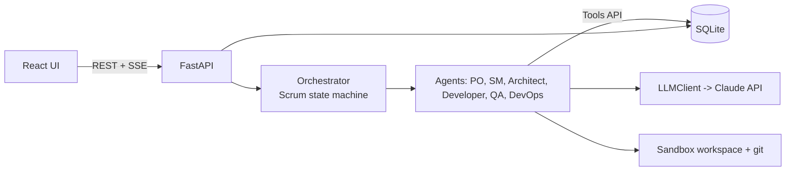

# Architecture

Multi-agent CASE workbench: a user submits a product idea; LLM agents playing Scrum roles take it
through the SDLC in sprints, producing artifacts (backlog, designs, code, tests, release) with
human approval at the ceremonies.

## Layout
| Path | Purpose |
|---|---|
| `workbench/schemas.py` | Shared pydantic contracts for agent outputs |
| `workbench/db/` | SQLAlchemy models, session, repository helpers |
| `workbench/llm/client.py` | `LLMClient.complete_json()` – validated JSON, retries, cache, mock |
| `workbench/agents/base.py` | `BaseAgent` (subclass this), `StubAgent` |
| `workbench/agents/tools.py` | `Tools` – the only way agents mutate state; each call logs an Event |
| `workbench/orchestrator/engine.py` | Phases, gates, agent registry |
| `workbench/api/main.py` | REST API |

## State machine
`idea -> backlog -> sprint_planning* -> execution -> review* -> retro -> release -> done`
(`*` = pauses for human approval; `POST /projects/{id}/approve`).
`PHASE_AGENTS` in `engine.py` maps each phase to the agent roles that run.

## How to write an agent (workstreams 2–4)
1. Subclass `BaseAgent` in `workbench/agents/<role>.py`; set `role`, `system_prompt`,
   `output_schema` (add new schemas to `schemas.py`).
2. Implement `build_prompt` (read state via `repo`), `mock_output` (canned dict valid for the
   schema, so tests/dev run with `MOCK_LLM=1`) and `apply` (persist via `Tools` only).
3. Register it: `Orchestrator(db, agents={"product_owner": ProductOwnerAgent()})`
   by adding it to `AGENTS` in `workbench/agents/registry.py` (the API uses that registry).
4. Add tests with mock mode.

## REST API
| Method | Path | Notes |
|---|---|---|
| POST | `/projects` | `{name, idea}` |
| GET | `/projects/{id}` | phase, awaiting_approval |
| POST | `/projects/{id}/advance` | run next phase (409 if awaiting approval) |
| POST | `/projects/{id}/approve?approved=true` | clear the gate |
| GET | `/projects/{id}/events?after=<id>` | activity feed (poll; SSE planned, issue #13) |
| *planned* | `/projects/{id}/backlog`, `/sprints`, `/tasks`, `/artifacts`, `/trace` | issue #13 |

## Data model
Project → Epic → UserStory → Task; Sprint ↔ UserStory; Artifact (+ TraceLink story→artifact);
Bug; Event (append-only log). See `workbench/db/models.py`.

## Conventions
Agents never write free text to the DB; outputs are schema-validated. Dev with `MOCK_LLM=1`;
responses from real runs are cached in `.cache/llm/`.
