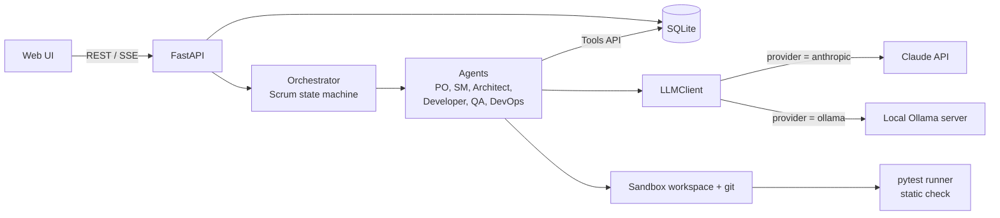
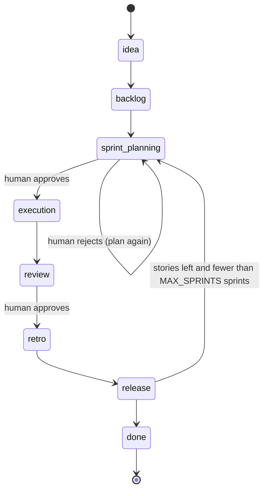
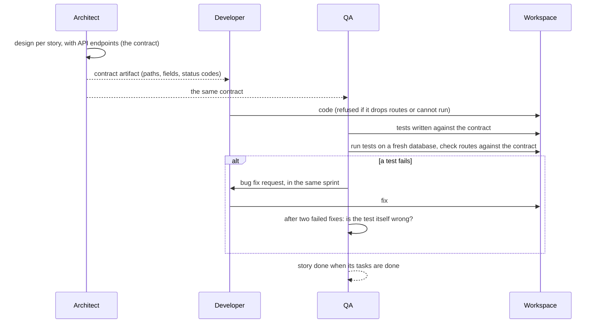
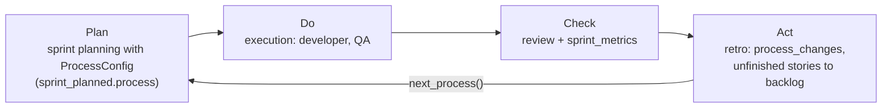
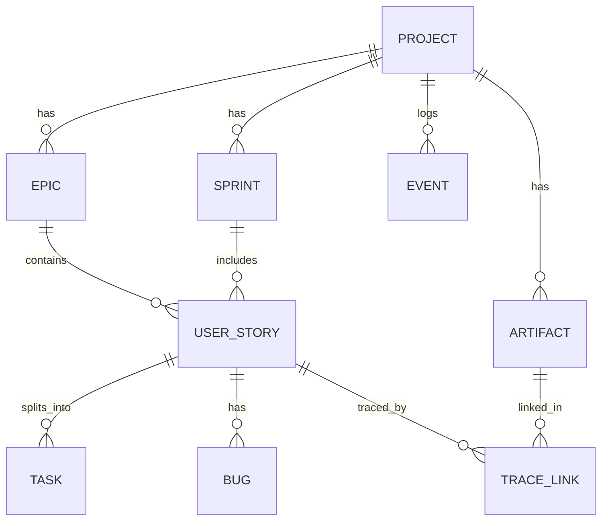

# Architecture

## Purpose
The workbench takes a product idea through the software life cycle with LLM agents that play Scrum
roles: requirements, design, code, tests and a release for every sprint. Agents work in sprints,
store everything in a shared database, and pause for human approval at the sprint planning and
sprint review ceremonies. The model behind the agents can be the Claude API or a local model served
by Ollama.

## Components

| Component | Location | Responsibility |
|---|---|---|
| API | `workbench/api/main.py`, `views.py`, `sse.py` | HTTP interface, input validation, error mapping, the event stream |
| Orchestrator | `workbench/orchestrator/engine.py` | Phase order, approval gates, which agents run in which phase |
| Process model | `workbench/process_model.py` | The process as data: roles, product flow, entry and exit criteria, RACI. It drives the orchestrator and generates `docs/process-handbook.md` |
| Process levers | `workbench/process.py` | The sprint's `ProcessConfig` (capacity, fix retries, test-first, working agreements) and the rule-based advisor behind the retrospective |
| Agents | `workbench/agents/` | One class per Scrum role; turn project state into LLM prompts and apply the results |
| Tools API | `workbench/agents/tools.py` | The only way agents change state; every call writes an Event |
| LLM client | `workbench/llm/client.py` | Providers, JSON-schema validation, retries, cache, usage log; mock, live, record and replay modes |
| API contract | `workbench/contract.py` | The Architect's endpoints per story: render, parse, and check the code against them |
| Static check | `workbench/staticcheck.py` | Undefined names and syntax errors in model-written code, by `ruff`, before it is written |
| Workspace | `workbench/workspace.py` | One directory and git repository per project; path safety |
| Test runner | `workbench/runner.py` | Runs the generated project's tests in a subprocess with a time limit and a fresh database |
| Release checks | `workbench/release_checks.py` | Starts the generated app, compares it with its contract, times it against the requirements, scans it for security mistakes |
| Export | `workbench/export.py` | A Markdown project report and a zip of the generated project |
| Requirements | `workbench/requirements.py` | Non-functional requirements and the rule-based backlog quality check |
| Metrics | `workbench/metrics.py` | GQM metrics, burndown and traceability details, computed from the event log and the project's records |
| Data layer | `workbench/db/` | SQLAlchemy models, sessions, query helpers |
| Contracts | `workbench/schemas.py` | Pydantic models for agent outputs |

The web UI (`frontend/`, React + Vite) has a project list, the backlog, the sprint board, a live
activity feed, an approval inbox, a traceability matrix and a Results page, and drives the phases
through the REST API. The API streams the event log to clients as Server-Sent Events. With
`WORKBENCH_API_TOKEN` set, every endpoint except `/health` needs a bearer token (or `?token=` for the
event stream) and the UI asks for it once; without it the API is open, so run it locally or behind
an SSH tunnel.

## LLM client
Every agent calls `LLMClient.complete_json(system, user, schema, ...)` and gets back a validated
pydantic object. Invalid JSON is retried with the validation error in the next prompt.

**Providers** (`LLM_PROVIDER`, used when a call is live):

| Provider | How it is called |
|---|---|
| `anthropic` (default) | The Anthropic SDK; needs `ANTHROPIC_API_KEY` |
| `ollama` | `POST /api/chat` to a local server with the agent's JSON schema as `format`, so the model can only answer in the shape the agent expects. No key needed. `OLLAMA_NUM_CTX` sets the context window, because Ollama's default truncates long prompts |

**Modes** (`LLM_MODE`): `mock` (canned answers, no calls; the default for development and CI),
`live` (a real call, answers cached by prompt), `record` (live, and every answer saved under a key
that names the call by meaning) and `replay` (answers read back from a scenario folder). The
scripted demo is a replay of hand-written answers.

**A model per role.** `WORKBENCH_MODEL_<ROLE>` overrides `WORKBENCH_MODEL` for one agent, for
example a code model for the Developer and QA and a general model for the rest. The model of a call
travels in a context variable, so the override never leaks into the next call.

## State machine
Gates pause the run until a human calls the approve endpoint.

The loop edges are in `Orchestrator.next_phase`: after `release` it returns to `sprint_planning`
while `more_sprints` holds (a story fits the next capacity and fewer than `MAX_SPRINTS` sprints
ran), and a rejected sprint plan is planned again. Rejecting the review is passed on to the
retrospective, which has to respond to the reason. `run_to_end` stops with an error after 200
steps.

`PHASE_AGENTS` in `engine.py` is built from the process model:

| Phase | Agents |
|---|---|
| backlog | product_owner, architect |
| sprint_planning (gate) | product_owner (refinement), scrum_master |
| execution | architect, developer, qa |
| review (gate) | scrum_master |
| retro | scrum_master |
| release | devops |

Roles without a registered agent fall back to `StubAgent`, which logs and does nothing. The release
phase runs `ReleaseAgent`, which wraps the DevOps agent and ends every sprint with a versioned
release: notes in `releases/v0.N.0.md`, a git tag in the sandbox repository, a `release` artifact
traced to the completed stories and a `release_created` event.

## How the agents work together
The agents do not talk to each other. They interact through the shared database and event log, an
API contract, and one direct call: QA asks the Developer to fix a bug.

The Architect, QA and the Developer also tell each other on the event bus (`agent_message`: a
contract is published, a bug needs fixing, a fix was tried, a test was corrected), and the activity
feed shows it as "Told the Developer: ...". The messages are structured notifications, not free-form
chat.

A story is done when all its tasks are done. Only the Developer (on a commit) and QA (when the
tests pass) close tasks, so the Scrum Master may assign tasks only to `developer` and `qa`, and
every story gets one task for each.

### Guards on model-written work
A small model makes the same mistakes again and again. These checks are plain code, not prompts,
so they hold whatever the model answers.

| Guard | What it stops | Where |
|---|---|---|
| Example request | The Developer and QA disagreeing on field names: every request body in the contract has one concrete `example` that both must follow | `contract.example_body` |
| Structured API contract | An empty or free-form spec. The Architect returns endpoints (method, path, request fields, status codes) that are rendered into the spec | `contract.render`, `schemas.EndpointOut` |
| Contract check | A route the contract names that the code lacks, or a wrong success status, found by reading the routes in `app/*.py`. Becomes a bug for the Developer | `contract.violations`, QA |
| Route guard | A rewrite of `main.py` that drops endpoints other stories use. The answer is refused and the Developer retries (up to two more times) with the removed endpoints named. A route moved behind a router prefix is not a removal | `contract.lost`, Developer |
| NUL characters and broken files | A model sometimes emits NUL bytes, which make Python refuse the whole file, and QA used to blame its own tests (the test only fails to import). Every file write strips NUL characters (`file_cleaned`); the static check compiles the file first, whatever ruff does; and QA reports an `app/` file that does not compile as a bug for the Developer, not as a mistake of its tests | `workspace.clean_text`, `staticcheck.syntax_problem`, `QAAgent._broken_app_files` |
| Modules that are not installed | `import validators` or `import pymongo` in code that runs where only fastapi, pydantic, httpx, uvicorn, sqlalchemy and the standard library are installed: every test of the story then fails at import, and a model keeps doing it when the prompt only says what is installed. Refused before the file is written, with the line shown | `staticcheck.missing_modules`, Developer |
| Static check | Undefined names and syntax errors, refused before they are written. The offending source line is shown to the model | `staticcheck.problems`, Developer |
| Path normalization | A path such as `/tests/x.py` rejected as unsafe; a leading slash means the repository root. Absolute paths stay rejected by the workspace | `workspace.repo_path` |
| Fresh database | A test run against an old SQLite file, which kept an old schema (`no such column`). Leftover `*.db`, `*.sqlite`, `*.sqlite3` files are deleted before each run | `runner.clear_databases` |
| Tables at import time | Tables created only in a startup event, which `TestClient(app)` does not run. The Developer creates them at module level and QA's tests use `with TestClient(app)` | prompts |
| Test or code? | A crash of the test code (a missing import) is a mistake of the test: QA rewrites it. An error that runs through `app/` is a bug for the Developer | `qa._test_side` |
| Test correction | A wrong test the Developer can never satisfy, such as one that asserts the exact text of an error message. After two failed Developer attempts QA checks the test against the contract and corrects it | `QAAgent._revise_tests(review=True)` |

## Sprint planning rules
The model proposes a sprint and the code decides (`scrum_master.plan_stories`), so a bad answer
cannot produce an empty or stuck sprint:

- Unknown or duplicate story ids and anything over the capacity are dropped.
- A story carried over twice with a bug still open is **blocked**: it is planned after other work,
  and only if room is left.
- The sprint is **topped up** by priority until the capacity is full. A plan the human rejected as
  too big is not topped up.
- One retrospective may lower the capacity by at most **30%**.
- A carried-over story gets its fix attempts **reset** when it is planned again. The Developer's
  prompt says how many earlier attempts failed and asks for a different approach.

## Backlog refinement
Before each sprint is planned the Product Owner refines the backlog (the first agent of the
`sprint_planning` phase). A rule-based check finds the stories that are not in a sprint and are
flawed (no Given/When/Then criteria, fewer than two, points off the scale or above 8, vague wording).
With nothing flagged there is no model call (`refinement_skipped`). Otherwise the model rewrites the
criteria, points and priority of the flagged stories only; the code ignores any other story it
returns, and runs the check again. See docs/agents.md.

## Release checks
When a sprint is released with a real model, `ReleaseAgent` looks at the generated app as a whole:
it starts `uvicorn app.main:app`, reads the OpenAPI document and compares it with the contract of
the completed stories, times the list endpoints against any time limit in the non-functional
requirements (a requirement without one is `unverified`) and scans `app/*.py` with the `ruff`
security rules. Each check is a `release_check` event, a section of the release notes and a row on
the Results page. A failed check is a finding, not a veto.

## Maintenance
A finished project takes a maintenance request (`POST /projects/{id}/maintenance`): the problem
becomes a top-priority fix story in a `Maintenance` epic and the next step plans a maintenance sprint
through the same phases as any other, with one extra sprint allowed past `MAX_SPRINTS` for each
request while its fix waits.

## Export
`GET /projects/{id}/report` is a Markdown report of the project (requirements, backlog, every sprint
and retrospective, releases and checks, open bugs) and `GET /projects/{id}/export` a zip of that report
and the generated project, both built from the database and the sandbox repository.

## Process improvement loop
Each sprint is one Plan-Do-Check-Act cycle. The retrospective turns measured results into typed
process changes (`ProcessChanges`), and the next sprint is planned with them. Nothing is stored in
new tables: the process used is in the `sprint_planned` event, the proposal is in `Sprint.retro`.

The same loop is the Quality Improvement Paradigm (QIP) from the course:

| QIP step | In the workbench |
|---|---|
| Characterize | Backlog, design and the metrics of earlier sprints (`metrics.py`) |
| Set goals | GQM goals G1 to G4 (`docs/metrics.md`) |
| Choose process | `ProcessConfig` (capacity, fix retries, test-first, working agreements) |
| Execute | The sprint: planning, execution, review |
| Analyze | Review and `sprint_metrics`, then the retrospective |
| Package | The retro's changes stored in `Sprint.retro` and recorded in the next `sprint_planned.process` |

Unfinished stories return to the backlog at the retro (`story_carried_over`). The levers and their
bounds are in docs/agents.md. Agents read the sprint's process from the database, so no lever needs
the orchestrator:

| Lever | Read by | Effect |
|---|---|---|
| `capacity` | Scrum Master planning | Points the sprint may commit to; a cut is limited to 30% |
| `max_fix_retries` | Developer, QA | Fix attempts per bug; QA's test/fix loop length |
| `test_first` | Developer, QA | QA writes the tests before the Developer codes; QA also runs stories whose tests never ran |
| `guidelines` | `BaseAgent.run` (all agents but the Product Owner) | Working agreements appended to the prompt |

## Results
`GET /projects/{id}/metrics` returns the GQM metrics for every sprint, computed from the event log
and the project's records. The **Results** page opens with a verdict (Complete, In progress, Nothing delivered) and the
points and stories delivered, then shows every sprint side by side (planned against completed, and
what the team did when it completed nothing), one sprint in focus with its burndown, quality, cost,
releases and the Plan-Do-Check-Act cards. The rules behind the wording are pure functions in
`frontend/src/lib/results.ts`. See docs/frontend.md and docs/metrics.md.

## Data model

- `UserStory.acceptance_criteria` is a list of Given/When/Then strings, at least two per story. QA
  turns these into tests.
- `TraceLink` ties a story to the artifacts (design, API contract, code, test, release) that
  satisfy it. `GET /projects/{id}/traceability` also returns every sprint a story was planned into.
- `Event` is append-only. It is the source for the activity feed and for most metrics.

## Design decisions
| Decision | Reason |
|---|---|
| Agents change state only through `Tools` | One audit trail, and no free text written to the database |
| Agent output is validated against a pydantic schema | Bad LLM output is retried or rejected instead of corrupting state |
| The model proposes, the code decides | Sprint plans, task owners and the acceptance of code are checked by rules; a small model's mistakes cannot stall the process |
| A structured contract between Architect, Developer and QA | The three agents agree on paths, fields and status codes, and the contract can be checked by code |
| Providers behind one client | The same agents run on the Claude API or a local model, with a model per role |
| `MOCK_LLM=1` by default | Development and CI cost nothing and are deterministic |
| SQLite | No setup for a three-day project; models are portable to Postgres |
| Agents registered by role in one dict | Teammates add agents without editing the orchestrator |
| The process is data (`process_model.py`) | The handbook, the entry and exit checks and the orchestrator come from one source |

## Known limitations
- **Live delivery is limited by the model.** On a local 14B model the library project delivered
  between 0 and 2 of 6 stories (0 to 5 of 19 points) in the latest runs. The agents and guards work,
  but a story completes only when all its tests pass, and the Developer and QA still sometimes
  disagree about a request or a response. Run-to-run variation is large.
- The Claude API path is covered in tests and mock mode but has not been run end to end; the live
  runs used Ollama.
- The scripted demo is hand-written, not a model run. What is real in it is the generated code, the
  test runs, the git history and every number on the Results page.
- Tests are API tests written by QA, plus the release checks (the app starts and serves its
  contract). There are no end-to-end or UI tests. Only a non-functional requirement that states a
  time limit is verified; the others are reported as unverified.
- Backlog refinement is rule-triggered: it runs when the backlog check flags a story, and it has not
  been exercised on a live model yet (the live backlogs were clean).
- The DevOps agent writes a Dockerfile and a CI workflow, but the image is built only where Docker
  is usable (it is skipped without Docker and failed on the test server for lack of permission). The
  release checks start the app directly, so they do not depend on Docker.
- Maintenance is a request that becomes a story and a sprint; there is no hotfix path that skips
  the sprint, and nothing monitors the released product.
- The optional API token is one shared secret kept in the browser. It keeps casual users out; it is
  not a user system, and it needs HTTPS or a tunnel on a shared network.
