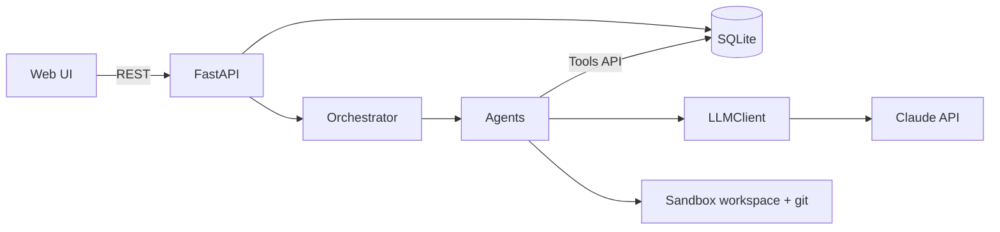
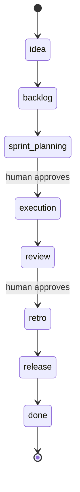
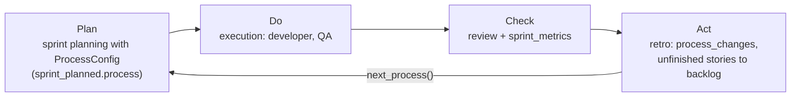
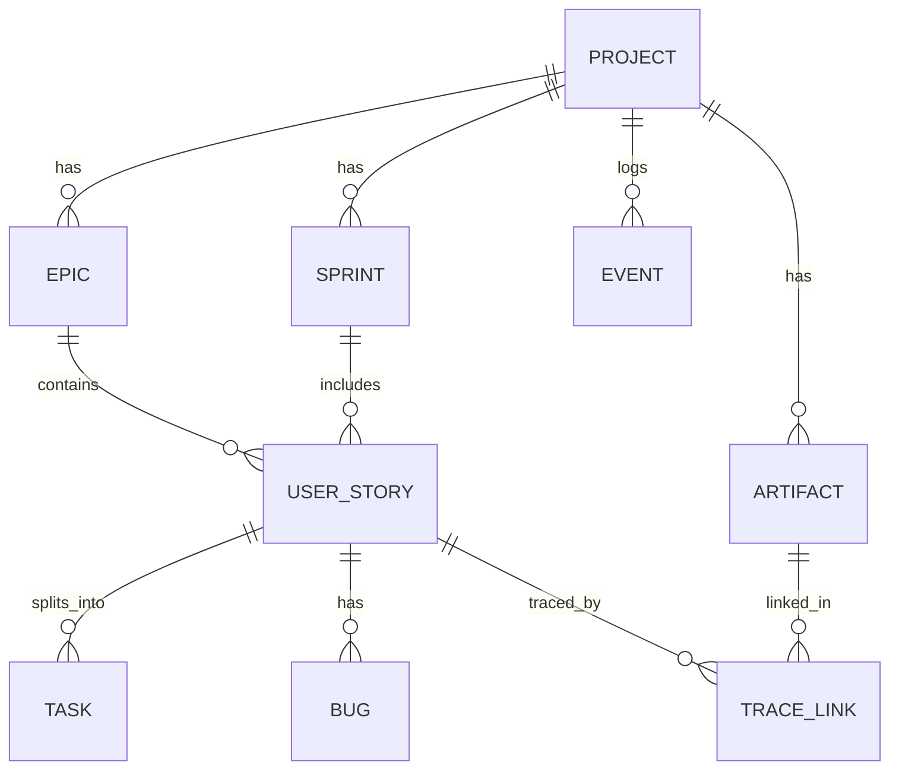

# Architecture

## Purpose
The workbench takes a product idea through the SDLC using LLM agents that play Scrum roles.
Agents work in sprints, store everything in a shared database, and pause for human approval at
the sprint planning and sprint review ceremonies.

## Components

| Component | Location | Responsibility |
|---|---|---|
| API | `workbench/api/main.py` | HTTP interface, input validation, error mapping |
| Orchestrator | `workbench/orchestrator/engine.py` | Phase order, approval gates, deciding which agents run |
| Agents | `workbench/agents/` | One class per Scrum role; turn project state into LLM prompts and apply results |
| Tools API | `workbench/agents/tools.py` | The only way agents change state; every call writes an Event |
| LLM client | `workbench/llm/client.py` | Calls Claude, validates JSON against a schema, retries, caches, mock mode |
| Data layer | `workbench/db/` | SQLAlchemy models, sessions, query helpers |
| Contracts | `workbench/schemas.py` | Pydantic models for agent outputs |

The web UI (`frontend/`, React + Vite) shows projects, the backlog, the sprint board, a live
activity feed and an approval inbox, and drives the phases through the REST API. The API streams
the event log to clients as Server-Sent Events (`workbench/api/sse.py`).

## State machine
Gates pause the run until a human calls the approve endpoint.

`PHASE_AGENTS` in `engine.py` maps each phase to the agent roles that run in it:

| Phase | Agents |
|---|---|
| backlog | product_owner, architect |
| sprint_planning (gate) | scrum_master |
| execution | architect, developer, qa |
| review (gate) | scrum_master |
| retro | scrum_master |
| release | devops |

Roles without a registered agent fall back to `StubAgent`, which logs and does nothing.

## Process improvement loop
Each sprint is one Plan-Do-Check-Act cycle. The retrospective turns measured results into typed
process changes (`ProcessChanges`), and the next sprint is planned with them. Nothing is stored in
new tables: the process used is in the `sprint_planned` event, the proposal is in `Sprint.retro`.

The same loop is the Quality Improvement Paradigm (QIP) from the course:

| QIP step | In the workbench |
|---|---|
| Characterize | Backlog, design and the metrics of earlier sprints (`metrics.py`) |
| Set goals | GQM goals G1 to G4 (`docs/metrics.md`) |
| Choose process | `ProcessConfig` (capacity, fix retries, test-first, working agreements) |
| Execute | The sprint: planning, execution, review |
| Analyze | Review and `sprint_metrics`, then the retrospective |
| Package | The retro's changes stored in `Sprint.retro` and recorded in the next `sprint_planned.process` |

Unfinished stories return to the backlog at the retro (`story_carried_over`) and are planned first.
The levers and their bounds are in docs/agents.md.

## Data model

- `UserStory.acceptance_criteria` is a list of Given/When/Then strings. QA turns these into tests.
- `TraceLink` ties a story to the artifacts (design, code, test) that satisfy it.
- `Event` is append-only. It is the source for the activity feed and for report metrics.

## Design decisions
| Decision | Reason |
|---|---|
| Agents change state only through `Tools` | One audit trail, and no free text written to the database |
| Agent output is validated against a pydantic schema | Bad LLM output is retried or rejected instead of corrupting state |
| `MOCK_LLM=1` by default | Development and CI cost nothing and are deterministic |
| SQLite | No setup for a three-day project; models are portable to Postgres |
| Agents registered by role in one dict | Teammates add agents without editing the orchestrator |

## Known limitations
- Rejecting an approval (`approved=false`) clears the gate and logs the rejection, but does not
  re-run the phase yet.
- Real Claude calls have not been exercised end to end; the code path is covered only in mock mode.
- There is no authentication. Run it locally only.
