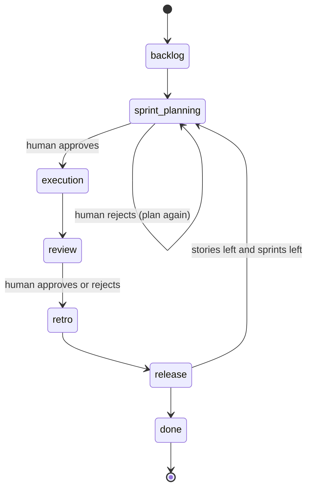

# Process handbook

The process that the AI Scrum team follows, written for the people who run it and for anyone who
needs to understand it. The structure follows the process handbook outline from the Software
Process Management lectures (lecture 8): introduction, definitions, process views, references and
appendices.

## 1. Introduction

**Purpose.** Tell process performers what to do, in which order, with which inputs and outputs,
and who is responsible. The performers are the six agents and the human who approves the gates.
The handbook is used every day, not kept for audits.

**Target audience.**
- The human stakeholder who approves or rejects sprint plans and sprint reviews.
- Developers of the workbench who change an agent or the orchestrator.
- Readers of the project report who want to see the process as a model.

**Process specifics.** Every role is played by an LLM agent, and a human is the only approver.
The process is a Scrum loop with two human gates. It measures itself with GQM metrics, and its
retrospective changes a few process levers for the next sprint (capacity, fix retries,
test-first, working agreements). Everything that happens is written to an append-only event log,
so the process actually followed can be rebuilt afterwards.

**Applicability.** Small web or API products that can be built in a few sprints by one team.
It is not meant for safety-critical systems: there is no formal verification and no independent
certification step.

**Relationship to other models.**
- *Scrum*: roles (Product Owner, Scrum Master, Developers), events (planning, review,
  retrospective) and artifacts (product backlog, sprint backlog, increment).
- *Iterative enhancement* (Basili and Turner): every sprint delivers a tagged release that builds
  on the previous one.
- *Plan-Do-Check-Act and GQM* (lecture 12): planning is Plan, execution is Do, the metrics and
  review are Check, and the retrospective's process changes are Act.
- *MVP-L* (lecture 11): each activity has entry and exit criteria and a product flow of the kind
  consume, produce and consume-produce.

**Version.** 1.1. It adds the explicit process model (entry and exit criteria, RACI),
non-functional requirements, the backlog quality check and gate rejection (issue #41).
Version 1.0 described the phases, agents and gates only.

**Structure.** Section 2 defines the terms. Section 3 shows the process from several views:
activities, control flow, product flow, roles, and entry and exit criteria. Section 4 lists the
references. The appendices hold templates and checklists.

## 2. Definitions

| Term | Meaning here |
|---|---|
| Activity | One phase of the process, e.g. sprint planning. Each phase is one entry in `workbench/process_model.py` |
| Agent (process performer) | An LLM agent, or the human, that carries out an activity |
| Role | A set of responsibilities: Product Owner, Scrum Master, Architect, Developer, QA, DevOps, human stakeholder |
| Work product | Anything an activity consumes or produces: stories, tasks, code, tests, release notes |
| Gate | A point where the process waits for the human to approve or reject |
| Entry criterion | A condition that should hold before an activity starts |
| Exit criterion | A condition that should hold when an activity ends; for execution this is the Definition of Done |
| Process lever | A setting the retrospective may change for the next sprint |
| Working agreement | A short rule the retrospective adds to every agent's prompt |
| NFR | Non-functional requirement: a constraint on the whole system with a measurable target |

**Abbreviations.** PO Product Owner, SM Scrum Master, QA quality assurance, AC acceptance
criterion, NFR non-functional requirement, GQM Goal-Question-Metric, PDCA Plan-Do-Check-Act,
RACI responsible, accountable, consulted, informed.

**How the model is described.** An activity *consumes* and *produces* work products. A role is
*responsible* for an activity (does the work) or *accountable* for it (decides). Criteria are
*advisory*: the orchestrator checks them and logs the result (`entry_criteria_checked`,
`exit_criteria_checked`). An unmet criterion is shown in the activity feed and at the gate, but
it does not stop the run. Lecture 11 calls this a proscriptive model, as opposed to a
prescriptive one. The human uses the result when deciding at a gate.

## 3. Process views

### Control flow



A rejected **sprint plan** returns its stories to the backlog and removes the tasks the plan
created. A carried-over story keeps its earlier tasks. The Scrum Master then plans the same
sprint again, and its prompt includes the human's reason. A rejected **review** does not repeat
the sprint. The retrospective is told the reason and must answer it in `went_wrong` and
`actions`.

<!-- generated:start -->
### Activities

| # | Phase | Activity | Purpose | Responsible | Agents | Gate |
| --- | --- | --- | --- | --- | --- | --- |
| 1 | `backlog` | Requirements and sprint-0 design | Turn the product idea into a validated product backlog and a first architecture. | Product Owner | Product Owner, Architect | - |
| 2 | `sprint_planning` | Backlog refinement and sprint planning | Refine the backlog stories that failed the quality check, then choose the stories for the sprint within capacity and split them into tasks. | Scrum Master | Product Owner, Scrum Master | Human approval |
| 3 | `execution` | Sprint execution | Design, build and test each sprint story until it meets the Definition of Done. | Developer | Architect, Developer, QA | - |
| 4 | `review` | Sprint review | Show the increment and its progress so the human can accept or reject it. | Scrum Master | Scrum Master | Human approval |
| 5 | `retro` | Sprint retrospective | Inspect the sprint's measured results and adapt the process for the next one. | Scrum Master | Scrum Master | - |
| 6 | `release` | Release | Package the increment: container, CI workflow, release notes and a version tag. | DevOps | DevOps | - |

### Product flow

| Activity | Consumes | Produces |
| --- | --- | --- |
| Requirements and sprint-0 design | Product idea | Product vision, Epics and user stories, Non-functional requirements, Backlog quality report, Architecture overview, Diagrams, API spec |
| Backlog refinement and sprint planning | Epics and user stories, Backlog quality report, Process levers, Retrospective actions, Rejection reason (when re-planning) | Refined stories, Sprint goal, Sprint backlog, Tasks |
| Sprint execution | Sprint backlog, Tasks, Architecture overview, Acceptance criteria, Non-functional requirements | Story designs, Code, Tests, Bug reports |
| Sprint review | Code, Tests, Tasks, Bug reports | Stand-up summary, Burndown snapshot |
| Sprint retrospective | Sprint metrics, Review feedback, Process levers | Retrospective, Process changes |
| Release | Code, Tests, Retrospective | Dockerfile, CI workflow, Release notes, Version tag |

### Responsibility assignment matrix (RACI)

R = responsible (does the work), A = accountable (decides), C = consulted, I = informed.

| Activity | Human (stakeholder) | Product Owner | Scrum Master | Architect | Developer | QA | DevOps |
| --- | --- | --- | --- | --- | --- | --- | --- |
| Requirements and sprint-0 design | C | R/A | I | R | I | I | I |
| Backlog refinement and sprint planning | A | R | R | I | C | C | I |
| Sprint execution | I | C | C | R | R/A | R | I |
| Sprint review | A | C | R | I | I | I | I |
| Sprint retrospective | I | C | R/A | C | C | C | C |
| Release | I | I | I | I | C | C | R/A |

### Entry and exit criteria

| Activity | Entry criteria | Exit criteria |
| --- | --- | --- |
| Requirements and sprint-0 design | The project has a product idea | The backlog has at least one story<br>Every story has acceptance criteria<br>A sprint-0 architecture exists |
| Backlog refinement and sprint planning | The backlog has stories not yet in a sprint | The sprint has at least one story<br>Every sprint story has tasks<br>Committed points do not exceed the capacity |
| Sprint execution | An active sprint has at least one story | Every sprint story has tests<br>No sprint story has an open bug<br>Every sprint story is done (all tasks done) |
| Sprint review | A sprint has been planned | A burndown snapshot is recorded for the sprint |
| Sprint retrospective | A sprint has been planned | The retrospective is saved |
| Release | The sprint's retrospective is saved | A release is recorded for the sprint |
<!-- generated:end -->

The tables above are generated from `workbench/process_model.py`. To change them, change the
model, then run `python scripts/process_handbook.py`; a test fails while they disagree. Lecture 8
recommends this: keep one process model and generate the handbooks from it.

## 4. References

- Lecture notes, Software Process Management, lectures 1 to 12 (`Lec Notes/`).
- K. Schwaber and J. Sutherland, *The Scrum Guide*.
- V. Basili and A. Turner, "Iterative Enhancement: A Practical Technique for Software
  Development", 1975.
- H. D. Rombach, MVP-L: a language for process modeling in-the-large, 1991.
- V. Basili, G. Caldiera and H. D. Rombach, "The Goal Question Metric Approach", 1994.
- Project documents: [architecture](architecture.md), [agents](agents.md),
  [metrics](metrics.md), [API](api.md).

## Appendix A. Templates

**User story** (Product Owner)
```
As a <role>, I want <goal>, so that <benefit>.
points: 1 | 2 | 3 | 5 | 8 | 13      priority: 1 (highest) to 5
```

**Acceptance criterion** (one testable string per criterion)
```
Given <context> When <action> Then <observable result>
```

**Non-functional requirement** (lecture 2: a goal such as "easy to use" is not enough)
```
category: product | organizational | external
requirement: The system shall <constraint>.
measure: <how it is verified, with a number>
```
For example: *product*, "The API shall answer list requests within a fixed time", measured as
"95% of requests answered in under 300 ms with 1,000 items".

## Appendix B. Checklists

**Backlog check (Definition of Ready).** The rules come from requirements validation in
lecture 2 and from the completeness and consistency analysis of process models in lecture 10.
`workbench/requirements.py` checks them after the Product Owner runs, and the Backlog page shows
the warnings.
- Every story has acceptance criteria, each in Given/When/Then form.
- Every story has a role, a goal and a benefit.
- No two stories have the same title.
- Points are on the 1, 2, 3, 5, 8, 13 scale, and no story is larger than 8.
- No vague words that cannot be verified (fast, easy, simple, user-friendly, ...).
- Every NFR has a measurable target (a number).

**Definition of Done.** These are the exit criteria of execution.
- Every sprint story has tests.
- No sprint story has an open bug.
- Every task of every sprint story is done.

## Appendix C. Tailoring

The retrospective may tailor the process for the next sprint within fixed bounds
(`workbench/process.py`):

| Lever | Range | Changed when |
|---|---|---|
| Capacity | 3 to 40 points | The team delivered less than it committed |
| Fix retries | 1 to 5 | A bug hit the retry limit |
| Test-first | on or off | Defects escaped into testing |
| Working agreements | at most 5 | The retrospective found a practice worth keeping |

The process each sprint actually used is recorded in its `sprint_planned` event. Lecture 5 calls
this the descriptive model; the levers in force for the next sprint are the prescriptive one.
